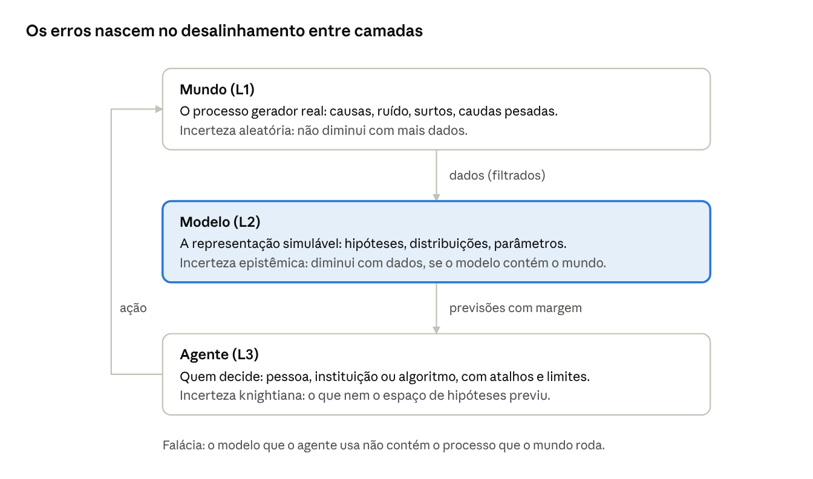
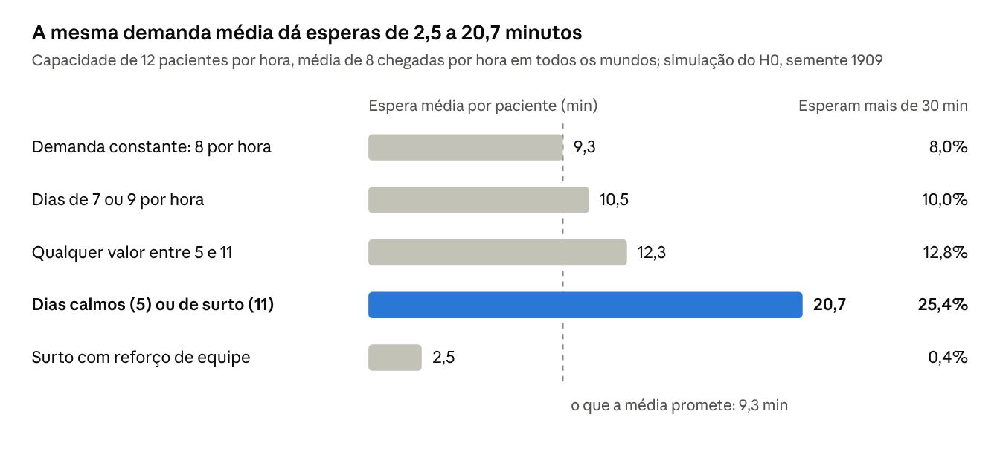
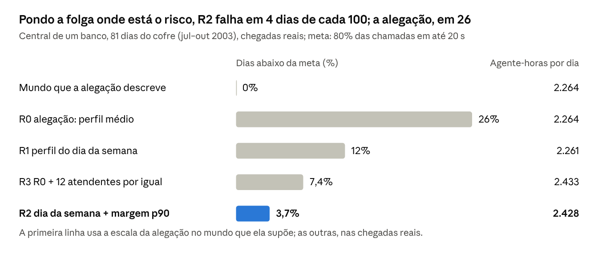

# "Estocologia": Velhas Fronteiras, Novos Horizontes

Silvano Neto · 14 de outubro de 2026, atualizado em 15 de outubro de 2026

## Resumo

Estocologia é a ciência (ou arte) que estuda o julgamento e a decisão sob incerteza. Este artigo defende que ela não é um ramo novo da estatística, mas uma costura: junta três tradições que cresceram separadas (a filosofia da indução, a inferência estatística e a mecânica dos processos estocásticos) e as organiza em três camadas, Mundo, Modelo e Agente. A tese central é que a maior parte dos erros de raciocínio sob incerteza não é erro de conta, e sim desalinhamento entre essas camadas.

O artigo percorre as velhas fronteiras que a disciplina herda, apresenta a arquitetura com que o projeto pretende operá-la (um hipergrafo tipado, auditado por agentes especializados e por cinco invariantes) e relata os primeiros resultados. Num posto de saúde simulado, a mesma demanda média produz uma espera média de 9,1 ou de 19,3 minutos (9,3 e 20,7 no gerador antigo em Python), conforme o mundo varie ou não. Em dados reais, a mesma lógica mostra que a escala padrão de uma central bancária, que promete cumprir a meta todo dia, falha em 26 de cada 100. O programa passou nos quatro horizontes do seu plano, mas não de primeira: o terceiro, a busca de estruturas causais invariantes entre áreas, exigiu sete rodadas, e o quarto, a calibração contínua fora do tempo, três tentativas no fluxo mais difícil. O artigo trata as falhas do caminho como resultado e termina com os horizontes que se abrem e as objeções que a disciplina precisa enfrentar.

Esta versão acrescenta a auditoria de fundo do programa, na seção 8: dez pontos que o texto supunha e que foram testados contra os próprios dados, entre eles o piloto cego da tese central, que empatou no teto, e o laço performativo, que a medição numa central real põe em torno de 0,15, e não nos 0,6 declarados. Aprofunda também cada passo com o material do curso que sustenta a disciplina, dezessete módulos centrais, vinte e cinco especiais e oito bancas. Entram a forma exata das contas que antes eram só nomeadas (Bayes em chances, a identidade de Meng, a porta dos fundos, o critério de Kelly, a decomposição de Murphy) e os casos que as tornam concretas, da mamografia ao navio de Bernoulli. Entram também três objeções novas, entre elas a de que o auditor do programa é parte interessada.

## 1. Introdução: decidir sem saber

Toda decisão que importa é tomada antes de sabermos o que vai acontecer. O médico prescreve sem conhecer a resposta daquele paciente, o juiz condena sem ter visto o crime, o gestor contrata pessoal para uma demanda que ainda não chegou. Em todos esses casos, alguém precisa transformar informação incompleta em uma ação concreta, e responder pelas consequências.

Há séculos existem ferramentas para isso: a probabilidade, a estatística, a teoria da decisão, a psicologia do julgamento. O problema é que elas raramente conversam. O estatístico calcula intervalos sem perguntar de onde vieram os dados; o filósofo discute a indução sem rodar uma simulação; o psicólogo cataloga vieses sem dizer em que ambiente o atalho seria ótimo. Cada um enxerga um pedaço do problema.

**Estocologia é a ciência (ou arte) que estuda o julgamento e a decisão sob incerteza.** O nome vem do grego *stókhos*, o alvo para onde se mira, a conjectura bem orientada. Não é uma escolha arbitrária: em 1713, Jacob Bernoulli chamou a sua obra de *Ars Conjectandi*, a arte de conjecturar, e definiu essa arte como *stochastice*. Três séculos depois, a palavra "estocástico" virou sinônimo de "aleatório" e perdeu o sentido original de mirar bem quando não se vê o alvo. A Estocologia quer recuperar esse sentido.

O "ou arte" da definição é deliberado. Julgar sob incerteza tem uma parte que se formaliza (a coerência das crenças, a atualização pela evidência, a margem de erro) e uma parte que não se formaliza por completo (decidir qual modelo vale a pena levar a sério, quando parar de coletar dados, quem paga se o erro acontecer). Uma disciplina honesta sobre incerteza precisa ser honesta também sobre os limites do próprio formalismo.

A disciplina tem um corpo de ensino, o curso *Pensamento Crítico e Modelos Estocásticos*, e este artigo se apoia nele. O curso é um arco, não um catálogo. Depois de um nivelamento (M0), a lógica da crença (M1 a M3) sustenta a leitura do acaso, da seleção e da informação (M4 a M6). Essa leitura sustenta a dinâmica do tempo, da memória e das caudas (M7 a M9) e a mecânica estocástica e a inferência ativa (M10 e M11). Daí se passa a aprender, intervir e decidir (M12 a M14), e tudo converge na crítica de modelos (M15). Vinte e cinco módulos especiais levam o mesmo raciocínio à prática de dados, à operação de modelos, à governança e à comunicação, e oito bancas o põem à prova. Cada conceito chega ligado ao anterior por uma ponte declarada, e uma pergunta reflexiva fecha o percurso: quando um modelo é bom o bastante?

## 2. Velhas fronteiras

A Estocologia não inventa seus problemas; herda-os. Três fronteiras antigas organizam essa herança, e cada uma delas separou pessoas que deveriam estar conversando.

**A fronteira entre disciplinas.** A filosofia perguntou se a indução se justifica. David Hume mostrou que qualquer defesa dela pressupõe que o futuro se parecerá com o passado, o que é circular. Karl Popper respondeu trocando a confirmação pela refutação; Duhem, Quine e Lakatos lembraram que nenhuma hipótese é testada sozinha. Em paralelo, a matemática construiu a probabilidade (Pascal e Fermat, Bernoulli, Bayes, Laplace, Kolmogorov) e a estatística construiu a inferência (Fisher, Neyman, a escola bayesiana). Uma terceira linhagem, a dos processos estocásticos (Markov, Langevin), estudou como o acaso se acumula no tempo. As três tradições raramente se citam.

Vista de perto, essa fronteira tem textura. Peirce obteve as três formas de inferência permutando as mesmas três proposições, regra, caso e resultado. Só a dedução preserva a verdade; a indução e a abdução ampliam o conhecimento e por isso podem falhar. A abdução, a inferência para a melhor explicação, escolhe a hipótese que torna os dados menos surpreendentes, mas só entre as hipóteses consideradas. É a precursora da máxima verossimilhança e herda o mesmo limite.

Popper enfrentou um problema que a fama do falsificacionismo esconde: "esta moeda é honesta" é compatível com qualquer sequência finita de lançamentos. Para testá-la, ele propôs uma convenção que trata como refutadoras as observações suficientemente improváveis, e toda convenção desse tipo erra a uma taxa fixada de antemão, que não cai com mais dados. Duhem e Quine completam o quadro: uma previsão frustrada refuta a teoria junto com as suas hipóteses auxiliares, nunca sozinha. Em 1846, a anomalia na órbita de Urano não derrubou Newton, porque Le Verrier postulou um planeta oculto e Netuno foi achado. A mesma manobra com o planeta Vulcano, para explicar Mercúrio, fracassou. Lakatos chamou o primeiro ajuste de progressivo e o segundo de degenerativo.

A linhagem de Langevin também tem uma lição própria. Em 1827, Robert Brown viu grãos de pólen se agitarem na água e pensou numa atividade da matéria viva; Einstein (1905) explicou o movimento pelos choques das moléculas, e Langevin (1908) escreveu a equação. Num sistema com dois estados estáveis, o tempo médio até o salto de um para o outro segue a fórmula de Kramers e cresce exponencialmente com a altura da barreira:

$$
\tau \approx \frac{2\pi}{\sqrt{U''(x_{\min})\,\lvert U''(x_{\max})\rvert}}\; e^{\Delta U/T}
$$

Esse tempo não tem memória: quem esperou muito não está mais perto do salto. Olhado só nos saltos, porém, o ruído parece um empurrão. Em 591 saltos simulados no curso, o ruído logo antes do salto apontou no sentido dele em 99% dos casos, sem nenhuma força externa. Procurar a causa de um salto é um erro de seleção; procurar a causa de uma mudança na frequência dos saltos, não.

**A fronteira entre risco e incerteza.** Em 1921, Frank Knight separou o risco, em que as probabilidades são conhecidas, da incerteza propriamente dita, em que nem a lista de possibilidades está disponível. Boa parte da teoria da decisão do século XX (von Neumann e Morgenstern, Savage) trabalhou do lado confortável dessa linha. O peru de Russell, alimentado pontualmente por mil dias, mostra o lado desconfortável: cada dia de dados torna o modelo dele mais confiante e, ao mesmo tempo, mais errado, porque o abate nunca esteve no seu espaço de hipóteses.

O peru pode ser simulado, e a simulação mostra que o problema não é falta de dados. Bertrand Russell contou a história com uma galinha; Taleb a recontou com o peru. Um animal que raciocina pela regra de sucessão de Laplace estima, depois de s sucessos em n dias,

$$
P(\text{sucesso amanhã}\mid s,n)=\frac{s+1}{n+2}
$$

e, na véspera do centésimo primeiro dia, está 99% confiante. A regra não é neutra, porque deriva de uma priori uniforme sobre a taxa: com sete sucessos em dez, a priori uniforme dá 0,667, uma uniforme sobre θ² dá 0,692 e uma uniforme sobre √θ dá 0,652. Até a ignorância tem forma. E quando o mundo muda devagar o modelo fixo falha em silêncio. Se o viés de uma moeda sobe de 0,2 para 0,6 e o modelo supõe uma moeda fixa, o intervalo de 95% encolhe de 0,140 para 0,035 e cobre a verdade em só 11% do tempo. Esquecer o passado, com um desconto de 0,99 por passo, restaura a cobertura para 99%, ao preço de intervalos três vezes mais largos.

**A fronteira entre a norma e o comportamento.** Kahneman e Tversky catalogaram como as pessoas se afastam das regras da probabilidade: ignoram a taxa-base, julgam a conjunção mais provável que suas partes. Herbert Simon e, depois, Gerd Gigerenzer responderam que um atalho só é erro relativo a um ambiente; quando a mesma informação é dada em frequências naturais ("8 em cada 10") em vez de porcentagens condicionais, muitos dos "vieses" desaparecem. O debate ficou parado entre dois campos, cada um com razão sobre metade do problema.

O curso propõe uma saída para esse impasse: um critério em vez de um lado. Um desvio é erro quando a informação certa estava disponível e a regra de combinação foi violada; é adaptação candidata quando a norma supõe uma informação que o ambiente não fornece de modo confiável. Num rastreamento com prevalência de 1%, quem ignora a taxa-base tem escore de Brier de 0,083, contra 0,009 de quem a usa. Num ambulatório de referência, onde a prevalência real é de 33%, quem insiste em 1% tem 0,28, contra 0,084 de quem a ignora. A mesma heurística é erro num ambiente e acerto no outro.

O veredito de "viés" depende também do modelo de quem julga. Lichtenstein e colegas (1978) viram que as pessoas superestimam as causas de morte raras e subestimam as comuns; Erev, Wallsten e Budescu (1994) mostraram que julgamentos ruidosos parecem subconfiantes ou superconfiantes conforme o eixo em que se condiciona. Numa simulação do curso, juízes sem viés nenhum, cada um com um sinal ruidoso, reproduzem a inclinação de 0,72 de Lichtenstein num eixo e são perfeitamente calibrados no outro. O caso mais célebre é o da mão quente. Por três décadas, o estudo de Gilovich, Vallone e Tversky (1985) foi o exemplo canônico de ilusão de padrão, até que Miller e Sanjurjo (2018) mostraram que o teste era viciado contra a mão quente: em três lances de uma moeda honesta, a proporção média de cara depois de cara é 5/12, não 1/2. Corrigida, a diferença nos dados de Cornell passa de +3 para +13 pontos. Acusar uma ilusão exige um modelo nulo correto.

| Ano | Marco | Fronteira que deixou |
| --- | --- | --- |
| 2000 | Judea Pearl, *Causality* | Causalidade formal, mas longe da prática estatística comum |
| 1996 | Deborah Mayo, teste severo | Filosofia do erro, pouco usada por quem roda os testes |
| 1974 | Kahneman e Tversky, heurísticas e vieses | Norma versus comportamento |
| 1955 | Herbert Simon, racionalidade limitada | O agente real, sem a matemática da inferência |
| 1954 | Leonard Savage, probabilidade subjetiva | Decisão sob risco, pouco sob incerteza radical |
| 1933 | Kolmogorov, axiomas da probabilidade | Rigor matemático, silêncio sobre interpretação |
| 1921 | Frank Knight, risco e incerteza | Risco mensurável versus incerteza não mensurável |
| 1908 | Langevin, dinâmica estocástica | O acaso no tempo, separado da inferência |
| 1763 | Ensaio de Bayes (publicado por Price) | Crença como probabilidade, longa disputa com os frequentistas |
| 1748 | Hume, problema da indução | Ciência empírica sem justificativa lógica |
| 1713 | Bernoulli, *Ars Conjectandi* | A arte de conjecturar nasce junto com a lei dos grandes números |

O que essas fronteiras têm em comum é que cada lado acerta sobre o seu pedaço e erra ao generalizar. A Estocologia parte da aposta de que os erros vivem justamente nas costuras.

## 3. Fundamentação: Mundo, Modelo e Agente

O primeiro gesto da Estocologia é separar três coisas que o senso comum mistura. O **Mundo** é a realidade que gera os dados e que nunca vemos inteira. O **Modelo** é a representação formal, simplificada e simulável que construímos para aproximá-lo. O **Agente** é quem decide: uma pessoa, uma instituição ou um algoritmo, sempre com tempo, atenção e computação limitados.

*As três camadas da Estocologia e o laço da ação.*

A separação tem uma consequência forte: **uma falácia não é um erro de aritmética, é um desalinhamento entre camadas.** A falácia do promotor acontece quando o Agente lê a verossimilhança do Modelo, P(evidência | inocente), como se fosse a resposta sobre o Mundo, P(inocente | evidência). O paradoxo da inspeção acontece quando o Agente impõe um Modelo estável a um Mundo que oscila. Nos dois casos as contas podem estar certas; o que está errado é a ponte.

A tese tem uma versão operacional: cada viés do catálogo clássico corresponde a um modelo de acaso ignorado. A negligência da taxa-base é a verossimilhança tomada pela posterior. A disponibilidade e a sobrevivência são uma amostra filtrada tomada pela população. A ilusão de padrão é a hipótese nula de acaso esquecida. A falácia do apostador atribui memória a um processo sem memória. A negligência de eventos raros modela como gaussiana uma cauda pesada. O excesso de confiança é má calibração, e o raciocínio motivado é escolher o modelo pelo resultado desejado. A palavra "viés" ganha assim três sentidos que a disciplina separa para depois reunir: o viés estatístico de um estimador, o viés do processo que produziu os dados e o viés cognitivo de quem raciocina. Nos três, o erro não é ruído que se cancela com mais dados; é uma distorção que se acumula.

Cada camada tem o seu tipo de incerteza, e confundi-los é um erro clássico. A incerteza **aleatória** pertence ao Mundo: é o acaso do próximo lançamento de uma moeda conhecida, e nenhuma quantidade de dados a elimina. A incerteza **epistêmica** pertence ao Modelo: é a nossa ignorância sobre o viés da moeda, e encolhe com cada lançamento. A lei da variância total separa as duas com precisão:

$$
\operatorname{Var}(Y) = \underbrace{\mathbb{E}_\theta\left[\operatorname{Var}(Y \mid \theta)\right]}_{\text{aleatória (Mundo)}} + \underbrace{\operatorname{Var}_\theta\left(\mathbb{E}[Y \mid \theta]\right)}_{\text{epistêmica (Modelo)}}
$$

A terceira, a incerteza **knightiana**, é a mais perigosa porque não aparece na equação. Ela surge quando o processo real está fora do espaço de hipóteses. Aí, mais dados não ajudam: estreitam o intervalo de confiança em volta da resposta errada, como no caso do peru.

| Incerteza | Camada | O que mais dados fazem | Como se mitiga |
| --- | --- | --- | --- |
| Aleatória | Mundo | Nada | Margens de segurança e redundância |
| Epistêmica | Modelo | Reduzem até zero | Amostragem e atualização bayesiana |
| Knightiana | Modelo e Agente | Nada, ou pior: falsa confiança | Cenários, robustez, estresse de premissas |
| Erro de especificação | Modelo | Precisão em torno do erro | Ampliar o espaço de hipóteses e auditar premissas |

A ferramenta matemática que atravessa as três camadas é modesta: a desigualdade de Jensen. Para uma função convexa f, o resultado médio não é o resultado do caso médio:

$$
\mathbb{E}[f(X)] \;\ge\; f(\mathbb{E}[X]), \qquad \mathbb{E}[f(X)] - f(\mathbb{E}[X]) \approx \tfrac{1}{2} f''(\mu)\,\operatorname{Var}(X)
$$

Em palavras: quando o sistema reage de forma não linear, a variabilidade do Mundo não se cancela na média; ela cobra um preço proporcional à sua variância. Planejar pelo caso médio é ignorar essa conta. A seção 5 mostra quanto ela custa num posto de saúde.

### 3.1 Crença e evidência

Por que graus de crença devem obedecer às regras da probabilidade? Dois argumentos independentes respondem. Cox (1946) mostrou que qualquer medida de plausibilidade consistente, que acompanhe o senso comum, obedece, depois de uma reescala, às regras da soma e do produto. Ramsey e de Finetti mediram a crença pelo preço de uma aposta. Quem declara 60% para chuva e 50% para não chuva aceita pagar 1,10 por dois bilhetes dos quais só um paga 1, e perde 0,10 com certeza. Um conjunto de preços admite esse "livro holandês" se e somente se violar os axiomas.

A coerência, porém, é barata. No laboratório do curso, o agente que comete a falácia da conjunção perde 0,05 por rodada para o apostador holandês e 0,60 para quem conhece o mundo; torná-lo coerente reduz a perda só para 0,55. O erro mais visível não era o mais caro. Quem pune o desacordo com o Mundo é a calibração, não a coerência. E quando a informação é incompleta, o princípio da máxima entropia de Jaynes (1957) manda escolher, entre as distribuições compatíveis com o que se sabe, a de maior entropia. Um dado de seis faces com média 4,5 recebe então cerca de 5% na face 1 e 35% na face 6; qualquer outra escolha supõe algo que não foi declarado.

A falácia do promotor, que a seção anterior só nomeou, tem uma forma exata. Escrita em chances, a regra de Bayes separa o que a evidência diz do que já se sabia:

$$
\frac{P(H\mid E)}{P(\neg H\mid E)}=\frac{P(E\mid H)}{P(E\mid \neg H)}\times\frac{P(H)}{P(\neg H)}
$$

Num rastreamento de mamografia, a doença atinge 1% das mulheres, o exame detecta 90% dos casos e dá positivo em 9% das saudáveis. Em frequências naturais a conta fica visível: de 10 000 mulheres, 100 estão doentes e 90 delas dão positivo; das 9 900 saudáveis, 891 também dão positivo. Das 981 positivas, só 90 estão doentes, cerca de uma em dez. Quando Gigerenzer e colegas fizeram essa pergunta a 160 ginecologistas, só 21% escolheram "cerca de 1 em 10". A mesma troca levou ao tribunal o "1 em 73 milhões" do caso Sally Clark, obtido multiplicando 1/8 543 por si mesmo, como se as duas mortes fossem independentes, e lido como a chance de inocência. Uma evidência é forte quando a razão de verossimilhança está longe de 1, não quando P(E | H) é alta.

Turing e Good mediram essa força em decibans, dez vezes o logaritmo decimal da razão, uma escala em que evidências independentes se somam. A independência é a condição que mais se esquece: dois exames positivos com uma causa comum de erro dão 51% pela soma ingênua e 30% na população simulada. O valor esperado do peso da evidência é a divergência de Kullback-Leibler, que nunca é negativa para a hipótese verdadeira:

$$
D(P_1\,\|\,P_0)=\sum_x P_1(x)\log\frac{P_1(x)}{P_0(x)}\ \ge 0
$$

Ela diz quantas observações bastam: para separar uma moeda de 60% de uma honesta com chances de 100 para 1, são precisos cerca de 229 lances. É com essa régua que os 2,2 bits dos incêndios dinamarqueses (seção 6) se revelam pouco. A evidência também engana pouco. Royall mostrou que, se a hipótese nula é verdadeira, a chance de a razão de verossimilhança alguma vez chegar a k é no máximo 1/k, qualquer que seja o tamanho da amostra:

$$
P_{H_0}\Big(\sup_n \mathrm{RV}_n \ge k\Big)\le \frac{1}{k}
$$

Em simulação, só 0,85% dos caminhos sob a nula chegaram a 20 decibans, contra um limite de 1%.

### 3.2 O filtro antes do dado

Os dados quase nunca chegam crus: passaram por telas institucionais, mecânicas ou comportamentais. Meng (2018) mostrou que o erro de qualquer média amostral é o produto exato de três fatores, qualidade, quantidade e dificuldade:

$$
\bar Y_n - \bar Y_N = \rho_{R,Y}\times\sqrt{\tfrac{1-f}{f}}\times\sigma_Y
$$

Aqui ρ é a correlação entre entrar na amostra e a resposta, e f é a fração da população amostrada. Numa amostra sorteada, ρ é minúsculo, da ordem de 1/√N. Quando a entrada depende do que se mede, o tamanho não salva. Em 1936, a *Literary Digest* recebeu 2,38 milhões de cédulas e previu a vitória de Landon com 57%; Roosevelt teve 60,8%, e Gallup acertou o vencedor com cerca de 50 mil entrevistas. Numa simulação na escala de 1936, uma correlação de −0,21 basta para que 2,4 milhões de cédulas errem por 18 pontos e valham o mesmo que uma amostra aleatória de cerca de 7 pessoas. Mais dados enviesados dão mais certeza sobre a resposta errada: é o peru outra vez, agora numa urna.

O filtro também fabrica relações. Berkson (1946) mostrou que duas doenças independentes aparecem associadas entre internados, porque cada uma aumenta a chance de internação: olhar só os selecionados é condicionar num colisor. Numa simulação do curso, talento e simpatia têm correlação +0,002 na população e −0,669 entre os que passam de um limiar. O caso inverso é o paradoxo de Simpson. Charig e colegas (1986) compararam duas cirurgias de cálculo renal. A cirurgia aberta vence nos cálculos pequenos (93% contra 87%) e nos grandes (73% contra 69%), mas perde no total (78% contra 83%), porque os casos difíceis iam para ela. Ponderando os estratos pela população inteira, ela tem 83,3% e a outra, 77,9%. Condicionar num confundidor fecha um caminho espúrio; condicionar num colisor abre um. "Controlar por tudo" não é neutro, e quem decide qual conta fazer é o grafo, não a tabela.

### 3.3 Da associação à intervenção

Pearl distingue três degraus de pergunta. A associação pergunta P(y | x): quem toma o remédio tem menos infarto? A intervenção pergunta P(y | do(x)): se eu tomar, meu risco cai? O contrafactual pergunta se eu teria infartado sem tomar. Cada degrau pede mais do modelo que o anterior, e a ponte entre os dois primeiros é um grafo causal, que os dados sozinhos não fornecem. Quando um conjunto Z bloqueia todos os caminhos que entram no tratamento por trás, sem conter nenhum descendente dele, vale o critério da porta dos fundos:

$$
P(y \mid do(x)) = \sum_z P(y \mid x, z)\,P(z)
$$

O caso clássico é o da terapia hormonal. Em 1991, a coorte do Nurses' Health Study, com cerca de 48 mil mulheres, relatou risco relativo de 0,56 de doença coronariana grave entre as usuárias de estrogênio. Em 2002, o ensaio sorteado da Women's Health Initiative, com 16 608 mulheres, encontrou razão de riscos de 1,29. As usuárias da coorte tinham outros hábitos, outra renda e outro acesso a médicos. A comparação não é perfeita (estrogênio isolado num caso, combinado com progestina no outro), mas a lição ficou. Ajustar "tudo o que foi medido" também não resolve: ajustar um mediador apaga o efeito, ajustar um colisor fabrica associação e ajustar um instrumento amplifica o viés que sobra.

A linguagem dos resultados potenciais, de Neyman e Rubin, dá a mesma lição numa linha. Cada pessoa tem dois desfechos possíveis, Y(1) com o tratamento e Y(0) sem ele, e só um é observado. A diferença ingênua entre tratados e não tratados se decompõe exatamente assim:

$$
\mathbb{E}[Y\mid D{=}1]-\mathbb{E}[Y\mid D{=}0] = \underbrace{\mathbb{E}[Y(1)-Y(0)\mid D{=}1]}_{\text{efeito nos tratados}} + \underbrace{\mathbb{E}[Y(0)\mid D{=}1]-\mathbb{E}[Y(0)\mid D{=}0]}_{\text{viés de seleção}}
$$

Sortear o tratamento zera o segundo termo. É exatamente o que a seção 6 encontra nos dados de LaLonde.

### 3.4 Quando a média deixa de existir

Jensen não é um truque isolado; é a raiz comum de várias patologias. A positividade da divergência de Kullback-Leibler é um caso dela, e a quebra de ergodicidade também. Numa dinâmica multiplicativa,

$$
X_{t+1} = X_t M_t, \qquad \mathbb{E}[M] > 1 \;\text{ e }\; \mathbb{E}[\ln M] < 0,
$$

a média do conjunto cresce enquanto quase toda trajetória decai (seção 7).

No limite, a média deixa de existir. Numa distribuição de Pareto, com P(X > x) = x^(−α), o momento de ordem k existe se e somente se k < α. Com α = 1,1, a média existe e vale 11, mas a média de um milhão de observações tem mediana 8,3, fica abaixo de 11 em 91% das amostras, e o intervalo de 95% usual contém o valor verdadeiro em só 26% delas. A razão é que a fração da média que vem de valores acima de um nível m é m^(1−α): em mediana, 28% da média ficam acima do maior valor que a amostra de um milhão viu. Para um erro típico de 1% seriam necessárias cerca de 10²² observações. O κ de Taleb mede essa distância até o regime em que a lei dos grandes números funciona na prática. Uma conferência própria do curso mostrou que a fórmula publicada de "quantos dados" superestima o número por fatores de cerca de 3 e 8, o que muda a conta, mas não a mensagem.

Quando a cauda manda, a gaussiana falha justamente onde importa. Pelo teorema de Fisher, Tippett e Gnedenko, o máximo normalizado de uma amostra só pode tender a uma de três famílias, Gumbel, Fréchet ou Weibull. Num exemplo do curso com 50 anos de retornos de cauda pesada, a perda de 1 em 100 anos vale 17,4%. Uma gaussiana ajustada aos retornos diários dá 3,9% e subestima a perda em todas as repetições; a distribuição de extremos acerta em mediana, com intervalo de 11% a 53%.

## 4. Arquitetura: uma máquina epistemológica auditável

Uma disciplina só vira prática quando ganha instrumentos. O projeto propõe operar a Estocologia como uma **máquina epistemológica auditável**: um sistema em que cada alegação empírica vira um pedaço de código executável, e em que nenhuma conclusão é aceita sem passar por testes automáticos. A ideia não é um buscador de textos que resume a literatura, mas um ambiente em que as hipóteses são simuladas e atacadas.

**O hipergrafo.** O conhecimento fica guardado como um grafo tipado, G = (V, E\_tree, E\_graph, H, Φ). Os nós (V) são conceitos, hipóteses, variáveis e conjuntos de dados; cada nó declara obrigatoriamente a sua camada (Mundo, Modelo ou Agente), o seu tipo de incerteza, uma definição formal e um ponteiro para código reprodutível com semente fixa. As arestas de árvore (E\_tree) registram o que depende do quê. As arestas transversais (E\_graph) são de três tipos: pontes matemáticas (a desigualdade de Jensen ligando módulos distantes), arestas causais do tipo do(x), e **arestas de patologia**, que marcam desalinhamentos: ligar um Mundo não linear a um Modelo que só olha o caso médio dispara o alerta de falácia da média.

**As cinco lentes.** As hiperarestas (H) envolvem grupos inteiros de nós e funcionam como perguntas que se fazem a qualquer problema:

- **Fluxonomia**: como a probabilidade e a informação fluem e se perdem.
- **Crononomia**: se a média entre muitos coincide com a média ao longo do tempo de um só (ergodicidade, ruína, critério de Kelly).
- **Escalonomia**: se a cauda é pesada a ponto de a média nem existir.
- **Morfonomia**: se a estrutura encontrada sobrevive quando o ambiente muda.
- **Crisonomia**: se a informação vale o seu custo e se as previsões estão calibradas.

Cada lente é mais que uma pergunta: tem uma grandeza que mede e um hábito crítico, e atravessa os conceitos sem acrescentar objetos. A Fluxonomia lê como corrente tudo o que circula entre as camadas, a probabilidade que sai de um estado e entra em outro, a informação que passa por um canal. A sua lei de base é contábil: a probabilidade de um estado varia pelo que entra menos o que sai, ∂ₜp = −∂ₓJ, e o hábito é perguntar se a conta fecha. Uma versão dessa contabilidade é a desigualdade do processamento de dados: se Z é obtido de Y, então I(X; Z) ≤ I(X; Y). Reprocessar, resumir ou copiar um dado nunca cria informação, e três jornais que publicam a mesma pesquisa valem um. A Crononomia mede tempos de mistura, de relaxação e de escape, e pergunta de que tempo se fala: o do processo, o do observador ou o da simulação. A Escalonomia mede o expoente de cauda, o tamanho efetivo, o horizonte e a capacidade do modelo. A Morfonomia reescreve o mesmo modelo em duas formas, porque duas representações podem dar as mesmas previsões e ainda assim autorizar conclusões diferentes sob intervenção, e só o que se conserva entre ambientes serve fora deles. A Crisonomia mede perda, escore próprio e valor da informação, e cobra de cada número o histórico de acertos na frequência que ele prometeu.

**Os agentes.** O trabalho é dividido entre agentes especializados, oito faixas coordenadas por um orquestrador. Eles não conversam em linguagem livre, que é ambígua e alucina; trocam **fichas** estruturadas, em YAML. Uma ficha não é um resumo: é uma lista fechada de perguntas que se faz a um texto, a um número ou a um modelo. Todas herdam quatro perguntas de partida. Qual é o processo gerador, escrito de modo simulável, e em que camada a alegação pode errar? O resultado é função não linear de algo que varia, o que tornaria o caso médio enganoso? Qual é a unidade de fato independente, e a margem foi calculada com ela? E, se o número veio de dados, de que verossimilhança veio, e o que o p-valor diz e não diz? Cada módulo acrescenta as suas. A ficha da evidência pede a taxa-base, as duas verossimilhanças e a posterior calculada de dois modos, em chances e numa árvore de 10 000 casos, que precisam coincidir; a do processo pergunta qual é a física do ruído; a do grafo causal começa pelo degrau da escada em que a afirmação está; a da crítica de modelos fecha a série e diz em que item cada ficha anterior entra.

| Agente | Papel | Garantia que entrega |
| --- | --- | --- |
| F1 Código | Transforma hipóteses em processos geradores executáveis | Semente fixa e testes de propriedades |
| F2 Dados | Audita a entrada do Mundo | Contrato de dados e a unidade independente certa |
| F3 Ciclo de vida | Testa o modelo no tempo | Validação em dados futuros, sem vazamento |
| F4 Fronteira | Roda a inferência pesada | Amostradores calibrados e cobertura garantida |
| F5 Governança | Cuida de legalidade e privacidade | Orçamento de privacidade em bits perdidos |
| F6 Justiça | Pergunta quem paga pelo erro | Auditoria de taxas de erro entre grupos |
| F7 Domínio | Traduz problemas de outras áreas | Elicitação de especialistas e termo de escopo |
| F8 Decisão | Converte o resultado em ação | Frequências naturais e cláusula de saída |
| M15 Orquestrador | Coordena e faz a banca adversarial | Ataque ao modelo antes da aprovação |

Cada linha da tabela esconde um ofício. O agente de dados (F2) começa por uma decisão que ninguém vê: o que é uma linha. Uma linha por pessoa, por dia ou por evento muda a média, a variância e a margem, e por isso o grão é declarado e provado com uma contagem. É a unidade independente vista do lado da tabela: quando 225 mil voos valem o mesmo que 364 dias (seção 6), o que falhou foi o grão. O mesmo agente caça o valor sentinela, o ausente gravado como 0, −1 ou 9999 que entra na soma como se fosse dado, e exige que a ingestão seja idempotente, porque todo dado chega mais de uma vez e rodar a carga duas vezes tem de dar o mesmo número.

O agente de fronteira (F4) sabe que, quando a posterior não tem forma fechada, o computador devolve uma amostra, não uma resposta. O diagnóstico de convergência mede se várias cadeias concordam entre si, não se o modelo está certo. O teste mais forte é a calibração por simulação: sorteia-se um parâmetro da priori, simulam-se dados com ele e roda-se o amostrador. Se o algoritmo é honesto, a posição do valor verdadeiro entre as L amostras da posterior é uniforme:

$$
\operatorname{rank}\big(\tilde\theta;\,\theta^{(1)},\dots,\theta^{(L)}\big)\sim \operatorname{Uniforme}\{0,\dots,L\}
$$

Para modelos de caixa-preta, a predição conforme dá uma cobertura garantida sem supor a forma da distribuição, P(Y ∈ C(X)) ≥ 1 − α; foi uma versão adaptativa dela que o H3 usou sob deriva.

O agente de governança (F5) parte de que dado pessoal não é um tipo de arquivo: é a combinação de campos que decide, e CEP, data de nascimento e sexo, juntos, identificam quase qualquer pessoa. Antes de tudo pergunta com que fundamento legal e para que fim o dado é tratado, e lembra que quem consente não é amostra aleatória, de modo que a inferência herda esse viés de seleção. Agregar não basta. A privacidade diferencial limita quanto a presença de uma pessoa pode mudar qualquer resposta. Para bases D e D′ que diferem em uma pessoa,

$$
\Pr[M(D)\in S]\ \le\ e^{\varepsilon}\,\Pr[M(D')\in S]
$$

e o ε é o orçamento, gasto a cada consulta. A medida mais barata continua sendo não coletar.

**O ciclo.** Uma pergunta percorre seis estágios: tradução e elicitação (F7); auditoria dos dados, da causalidade e da ética (F2, F5, F6); simulação contra um modelo nulo (F1, F4, F3); passagem pelas cinco lentes; banca adversarial, que devolve o trabalho ao estágio que falhou; e, só então, a decisão comunicada (F8).

A banca adversarial não lê relatórios: ataca o artefato ao vivo. Três falhas eliminam o trabalho antes de qualquer discussão de mérito: vazamento temporal, contrato de dados violado sem tratamento e ausência de um responsável humano nomeado. Depois, cada faixa recebe o seu ataque. A de dados recebe um lote com registros corrompidos e precisa isolá-los. O modelo em operação recebe ao vivo um lote com deriva forte. O instrumento de inferência recebe um conjunto de dados patológico, para ver se a sua incerteza denuncia a inadequação. A auditoria de justiça tem de inverter a métrica escolhida e mostrar quem passaria a pagar. O documento de decisão enfrenta uma crise que viola a própria cláusula de saída. Um trabalho completo com uma faixa fraca declarada vale mais que um trabalho uniforme sem lacuna admitida.

**Os cinco invariantes.** Nada entra no grafo sem passar por cinco portões, que funcionam como travas de banco de dados:

1. **Φ1, simulabilidade**: toda alegação vira código com semente declarada e testes. Prosa não basta.
2. **Φ2, margem e unidade**: todo número vem com margem de erro, calculada sobre a unidade que é de fato independente.
3. **Φ3, diagnóstico e teste severo**: antes de ler um padrão, audita-se o filtro da amostra, desenha-se o grafo causal e confronta-se a hipótese com um modelo nulo simulado.
4. **Φ4, escopo ecológico**: a decisão é julgada pelo ambiente em que vai operar, e sai com termo de escopo e uma cláusula objetiva de quando abandoná-la.
5. **Φ5, resolução da pergunta**: quando a unidade de decisão é o dia ou mais grossa, resolução agregada (R0) reprova e exige-se a faixa temporal compatível com a pergunta.

Para não explodir em custo nem em falsas descobertas, a pesquisa passa por um funil. Primeiro corta-se o que, mesmo com resposta perfeita, não mudaria nenhuma decisão (valor esperado da informação). Depois corta-se o que não é identificável com os dados disponíveis. Depois, o que não supera o modelo nulo. Só o que sobra recebe inferência cara. Toda tentativa fica registrada, inclusive as que falharam, para que o relatório final declare quantas especificações foram tentadas.

Cada corte do funil tem uma conta por trás. O primeiro é o valor da informação. Se proteger custa C e não proteger custa L quando o evento ocorre, protege-se quando p > C/L, e uma informação vale pelo quanto pode mover a probabilidade para o outro lado desse limiar, não pelos bits que carrega. O valor de saber o estado do mundo antes de agir tem um teto,

$$
\mathrm{EVPI} = \mathbb{E}_\theta\big[\max_a U(a,\theta)\big] - \max_a \mathbb{E}_\theta\big[U(a,\theta)\big]
$$

e o valor de qualquer exame real fica entre zero e ele. Num exemplo do curso, uma doença tem prevalência de 0,3 e trata-se quando a chance passa de 0,10. Dois exames carregam a mesma informação, 0,319 bit. O exame sensível vale 0,419; o específico vale zero, porque mesmo o seu resultado negativo deixa a chance acima do limiar e não muda a ação.

O segundo corte é a identificabilidade: um parâmetro é identificável quando valores diferentes geram dados diferentes. No início de uma epidemia, os casos crescem como exp((β − γ)t), e os dados determinam a diferença β − γ, não a razão R₀ = β/γ. Com 25 dias de casos simulados, em que a verdade é R₀ = 2, os valores compatíveis vão de 1,38 a 5,90, e o tamanho final previsto da epidemia vai de 50% a 100% da população. Com 45 dias, R₀ fica entre 2,00 e 2,24, mas aí a curva já dobrou. Tomar a duração da infecção de outros estudos estreita R₀ para 1,81 a 2,11. Isso não é defeito, desde que se declare que a margem da conclusão passou a ser a da fonte.

O terceiro corte, o modelo nulo, é a defesa contra o jardim dos caminhos que se bifurcam. Simmons, Nelson e Simonsohn (2011) simularam quatro liberdades comuns num experimento sem efeito (quando parar de coletar, quais variáveis usar, quais casos excluir, quais comparações relatar) e viram a taxa de falsos positivos subir de 5% para 60,7%. Ioannidis (2005) mostrou que o valor preditivo de um achado significativo depende do poder 1 − β e das chances R de uma hipótese da área ser verdadeira:

$$
\text{VPP}=\frac{(1-\beta)R}{R-\beta R+\alpha}
$$

A Open Science Collaboration (2015) replicou 100 estudos de psicologia: 97% dos originais tinham p < 0,05, contra 36% das replicações. Nem a validação cruzada escapa. Num mundo de puro ruído, com 50 casos e 50 preditores sem relação com nada, sortear 500 modelos e ficar com o de menor erro de validação produz um vencedor que parece melhor que prever zero em 73% das repetições e não é melhor em nenhuma diante de dados novos. Por isso a regra de Mayo é a do funil: um resultado só é evidência se o procedimento provavelmente teria dado errado caso a afirmação fosse falsa. Numa simulação, o mesmo "p = 0,04" tem severidade 0,96 quando vem de um teste pré-registrado e 0,42 quando vem do jardim.

O avesso também vale: um ajuste só é evidência se o modelo podia ter falhado. Se um semiplano separa perfeitamente 50 pontos, isso teria chance de 2 × 10⁻¹² caso os rótulos fossem acaso, cerca de 39 bits de evidência. Uma tabela que guarda cada rótulo também os separa e não traz bit nenhum, porque separaria qualquer coisa. É a falseabilidade de Popper em forma de conta, que a teoria de Vapnik e Chervonenkis mede pela capacidade da família de modelos.

## 5. Um primeiro experimento: a fila do posto de saúde

O primeiro teste da arquitetura (o horizonte H0 do plano do projeto) foi deliberadamente modesto: um posto de saúde simulado, o Lab 0 do curso. O posto atende 12 pacientes por hora e recebe, em média, 8. A alegação a examinar é a de qualquer planilha de gestão: "com essa média de demanda, a espera média será de uns 9 minutos".

O sistema fez o que os invariantes exigem. Traduziu a alegação em um processo gerador executável, com semente fixa (Φ1), e rodou cinco mundos que têm exatamente a mesma demanda média, mas variabilidades diferentes:

*Espera média por mundo simulado no Lab 0 (H0, h0-lab0/resultados.json).*

Se a demanda é constante, a promessa se cumpre: 9,1 minutos (9,3 no gerador antigo em Python). Se os dias alternam entre calmos (5 pacientes por hora) e de surto (11), a espera média mais que dobra, para 19,3 minutos (20,7 no gerador antigo), e cerca de um em cada quatro pacientes espera mais de meia hora. Nada mudou na média; mudou a variabilidade, e a fila é uma função convexa da demanda. É a desigualdade de Jensen cobrando a sua conta. O último mundo mostra o outro lado: reforçar a equipe só nos dias de surto derruba a espera para 2,5 minutos.

Vale olhar de onde vem a promessa. Ela sai da fórmula clássica de uma fila com um atendente,

$$
W(\lambda)=\frac{\lambda}{\mu(\mu-\lambda)}
$$

que, com λ = 8 e μ = 12 por hora, dá 10 minutos de espera no longo prazo. A mesma fórmula, aplicada a dias que alternam entre 5 e 11 pacientes por hora, daria uma média de 29,3 minutos, e a simulação dá 19,3 (20,7 no gerador antigo). A diferença tem três causas que ensinam algo. Um dia de 10 horas não é o longo prazo da fórmula: nos dias de surto, a espera fica em 28,2 minutos, não nos 55 que ela prevê. Além disso, 68,8% dos pacientes (11 em 16, aproximado por 70%) chegam nos dias de surto, de modo que a média por paciente pesa mais os dias ruins. E a fórmula não está errada: responde à espera de longo prazo com demanda constante, quando o gestor perguntava quantos esperam demais nos dias ruins. Jensen nem precisa de curvatura para morder. Numa prova com média 6,2 e nota mínima 6, o "aluno médio" passa, mas 45,1% reprovam.

O experimento produziu três resultados que vão além do exemplo didático.

1. **O modelo nulo arbitra a margem de erro (Φ2).** Quem trata cada paciente como observação independente obtém uma margem de ±0,07 minuto; quem trata o dia como unidade obtém ±0,51, sete vezes maior. Qual está certa? Em vez de discutir a convenção, o sistema repartiu ao acaso 4 000 dias simulados em duas metades e mediu a diferença entre elas. O desvio observado foi 0,216; a margem por dia previa 0,227 e a margem por paciente previa 0,047. A pseudorreplicação deixou de ser uma questão de gosto: foi refutada pelos dados.
2. **O teste severo (Φ3).** A diferença entre o mundo constante e o mundo com surtos, 10,2 minutos (11,4 no gerador antigo), fica a dezenas de desvios do que o acaso produziria. Em 2 000 repartições aleatórias, o modelo nulo nunca passou de 0,81 minuto.
3. **A armadilha da mediana.** No mundo com surtos, a mediana da espera é 8,1 minutos no H0 (8,6 no Capítulo 5; 9,3 no gerador antigo, o mesmo número que a alegação promete como média). Um gestor que olhe "o paciente típico" verá a promessa cumprida. Toda a diferença está na cauda, e é por isso que a arquitetura proíbe reportar uma média sozinha: exige mediana, quantis e a curva acumulada.

A pseudorreplicação tem uma teoria por trás. Em 1913, Markov contou vogais e consoantes nas 20 000 primeiras letras do *Ievguêni Oniéguin* e mostrou que a lei dos grandes números sobrevive à dependência. Mas a dependência muda quanto a amostra vale. Como as letras tendem a alternar, um bloco de 100 delas vale cerca de 330 letras independentes; numa cadeia "pegajosa", em que cada estado tende a se repetir, 100 observações valem bem menos que 100. O tamanho efetivo de uma amostra é uma propriedade do processo, não da contagem, e é por isso que os pacientes de um mesmo dia, que compartilham a mesma demanda, não contam como observações independentes.

Tudo isso passou pelos portões e reproduziu, na edição Rust (`labs --cap 5` e `stochology-h0`), a divergência declarada contra o gerador antigo (161 867 e 160 220 pacientes). O resultado é pequeno, mas o seu valor está no método: qualquer pessoa pode rodar o código de novo e obter os mesmos números, com o mesmo hash.

## 6. Do simulado ao real: o que os dados disseram

Depois do Lab 0, o programa percorreu os quatro horizontes do plano com bases públicas reais e passou nos quatro, os dois últimos só depois de várias rodadas de falha. As falhas foram mantidas como resultado: cada mudança de critério, de teste ou de dados foi declarada, com hash, antes de rodar, e nada foi ajustado depois de ver o resultado. A pesquisa foi encerrada em 15 de outubro de 2026; código, dados com hash e resultados estão no repositório do projeto.

| Horizonte | Dados reais | Portão de saída | Resultado |
| --- | --- | --- | --- |
| H0 Semente | 2,65 milhões de chamadas de uma central bancária (2003) | Φ1 a Φ4 e reprodução limpa | Passou |
| H1 Ciclo completo | Dow Jones 1885–2023; LaLonde (NSW e CPS); incêndios dinamarqueses 1980–1990 | Um projeto aprovado na banca adversarial | Passou: 2 de 3 projetos aprovados; o de cauda pesada foi reprovado |
| H2 Transferência | 12 domínios de conveniência; depois bases com intervenções conhecidas, câmaras físicas, deleções de genes em levedura e um ensaio de cardiologia do FDA | Conjunto causal invariante (ICP) não vazio em 3 áreas | Passou na sétima rodada: 4 áreas; a auditoria de fundo (seção 8) troca a Educação pela Genética replicada, e o portão segue de pé com três áreas |
| H3 Malha contínua | 6 fluxos em replay sob relógio, 453 973 previsões; depois voos de 2023, prisões de 2020–2021 e paradas de trânsito em Rhode Island | Calibração fora do tempo, zero vazamento, controle de Goodhart | Passou na terceira tentativa do fluxo de prisões; habilidade baixa (+0,019) |

### H0 real: a central de chamadas

O Lab 0 supunha uma demanda que alterna entre 5 e 11 por hora. No H0 real, a demanda é observada: 164 dias úteis de uma central bancária norte-americana, contados a cada 5 minutos. A alegação é a prática padrão do setor: escalar cada meia hora pela fórmula de Erlang C sobre a taxa média do histórico garante 82% das chamadas atendidas em até 20 segundos, todo dia.

No mundo que a alegação descreve, nenhum dia fica abaixo da meta. Nas chegadas reais, cerca de um em cada quatro fica. A demanda não é Poisson: entre dias, o desvio é de cerca de 2 900 chamadas, onde Poisson preveria 180. E a desigualdade de Jensen aparece dentro da própria fórmula: aplicado à taxa real de cada dia, o Erlang C da alegação dá em média 57%, não 82%, porque o nível de serviço é côncavo na carga. A unidade independente, de novo, é o dia: o modelo nulo de metades deu desvio de 0,0474, contra 0,0470 previsto pelo dia e 0,0033 pela chamada.

É o caso de manual da checagem preditiva, de Box a Gelman e Shalizi: simular réplicas do modelo ajustado e ver em que estatística os dados reais caem fora delas. Num exemplo do curso, um modelo Poisson passa na média, falha na variância (nenhuma réplica chega perto) e subestima em 42 vezes a chance de um dia de pico. Um modelo pode servir para dimensionar a equipe média e ser perigoso para o plantão de pico; a pergunta certa não é se ele é verdadeiro, mas para que decisão é bom o bastante.

*Dias abaixo da meta por regra de escala na central bancária (H0 real, h0-real/README.md).*

A decisão (Φ4) compara regras de escala de custo parecido. Acrescentar 12 atendentes por igual leva a 7,4% de dias abaixo da meta; gastar a mesma folga onde está o risco, pelo dia da semana e por uma margem para a variação residual, leva a 3,7%. Ficam supostos o tempo de atendimento e a paciência dos clientes, que a base não traz, e a auditoria de fundo varreu a malha inteira (atendimento de 3 a 6 minutos contra paciência de 1 a 10): nenhum ponto troca a regra vencedora, a alocação por risco vence em 20 dos 24 pontos e empata nos quatro de menor paciência, e no pior caso ela segura 14,2% dos dias abaixo da meta contra 37,7% da regra da alegação. O eixo do atendimento quase não move o resultado; a paciência move. O domínio de saúde ficou de fora porque os portais do DATASUS estavam fora do alcance da rede — o que a auditoria contornou pelo espelho aberto da PhysioNet (seção 8).

### H1 real: três alegações, três destinos

**Alavancar o Dow Jones.** A alegação: "alavancado 3 vezes, o índice rende 3 vezes mais, e quem segura por décadas sempre ganha". A soma aritmética daria cerca de 0,20 ao ano; o crescimento ao longo do tempo foi de 0,051 sem alavancagem e 0,060 com 3 vezes. Em janelas de 20 anos, 96% terminam acima do ponto de partida sem alavancagem e 64% com 3 vezes. Com 3 vezes, a riqueza média chega a 19 vezes o capital, mas a mediana fica em 2,1: a média de conjunto e a trajetória típica se separam, como a Crononomia prevê. Só o 19 de outubro de 1987 tira 68% do capital alavancado. A refutação vale para "rende 3 vezes" e "sempre ganha", não para "alavancar nunca compensa".

**O experimento de LaLonde.** Comparar participantes de um programa de treinamento com trabalhadores de uma pesquisa nacional dá um efeito negativo no emprego (−10,7 pontos). O experimento sorteado mostra +11,1. O ajuste por escore de propensão chega a +9,6, perto do valor certo, mas o teste severo mostra que acertou sem merecer: um tratamento inócuo daria +9,0 dentro da mesma faixa. Um placebo, usando o emprego de 1975 como desfecho, revela que a seleção ainda está lá.

A decomposição da seção 3.3 explica o sinal trocado. A comparação com a pesquisa nacional soma ao efeito do programa um termo de seleção, a diferença entre o que os participantes e os não participantes teriam ganhado sem o programa, e esse termo é grande e negativo, porque quem procura um programa de treinamento estava em pior situação. O sorteio zera esse termo, e o escore de propensão tenta estimá-lo pelas variáveis observadas. O placebo com o emprego de 1975, anterior ao programa, é uma estimativa direta dele, e ela não deu zero.

**Os incêndios dinamarqueses.** Uma resseguradora vê 36 meses sem sinistro numa faixa alta de perdas e conclui que o risco é desprezível. A janela limpa vale apenas 2,2 bits de evidência, e a regra de sucessão de Laplace dá 1 chance em 38 por mês, não zero. Com a alavancagem que a alegação justificaria, a resseguradora é arruinada em agosto de 1989. Mas o orquestrador reprovou o projeto: no cofre, nenhum previsor venceu a frequência histórica simples, porque os sinistros cresciam 4,6% ao ano. A alegação perde, mas o modelo não ganha o direito de decidir.

O curso tem um análogo exato. Uma estratégia que vende seguro ganha 1% por semana e perde 50% com chance de 0,4%. Um histórico de 250 semanas não mostra nenhuma perda em 37% das vezes, e quem estima a chance pela frequência observada conclui que ela é zero e alavanca. Entre 10 000 investidores simulados, 35,8% dos que apostam pelo critério de Kelly com a probabilidade estimada se arruínam, embora essa regra tenha a maior riqueza média; com a regra de sucessão de Laplace, ninguém se arruína.

### H2: o portão que custou sete rodadas

O H2 testou se o método transfere entre áreas. Doze domínios reais (educação, logística, agronomia, clima, crédito, saúde, direito, entre outros) foram plugados pelo mesmo pacote padronizado; dez desses pacotes foram escritos por agentes que só leram o contrato e dois exemplos. O portão escolhido pelo plano era exigente: a Predição Causal Invariante (ICP), que procura as causas cuja relação com o resultado não muda de um ambiente para outro, deveria encontrar um conjunto não vazio em pelo menos três áreas distintas.

O ICP parte de uma afirmação formal. Se S é o conjunto das causas diretas de Y, a distribuição P(Y | X_S, E = e) é a mesma em todo ambiente e que intervém nas outras variáveis sem intervir na equação de Y. Uma relação causal sobrevive à troca de ambiente; uma correlação de conveniência, não. O método devolve a interseção de todos os conjuntos que passam no teste de invariância, e a sua garantia é assimétrica: com probabilidade de pelo menos 1 − α, o conjunto devolvido só contém causas diretas, mas nada garante que contenha todas. Abster-se, devolvendo o conjunto vazio, é resultado, não falha. É também uma resposta à crítica de Lucas (seção 7): só o que é invariante entre regimes merece uso quando o regime muda.

Na primeira rodada, encontrou em uma, o direito. Nos outros domínios, ou rejeitou todos os conjuntos, porque os ambientes de conveniência (ano, região, aeroporto) agem direto no resultado, ou aceitou tantos que a interseção ficou vazia. O diagnóstico foi que o ICP padrão, com amostras grandes, rejeita qualquer desvio do modelo linear gaussiano. Seguiram-se seis rodadas, cada uma com a mudança declarada e registrada com hash antes de rodar: bases em que o ambiente é uma intervenção documentada, um teste de invariância não paramétrico, uma regra que descarta conjuntos sem poder de teste, câmaras físicas com o grafo causal conhecido, deleções de genes em levedura e, por fim, um ensaio clínico de cardiologia.

O momento mais limpo foi o túnel de luz. Numa câmara física construída para estudar causalidade, o ICP recuperou exatamente os pais verdadeiros da corrente elétrica, os três LEDs, e deixou de fora sensores fortemente correlacionados com ela. Foi a primeira vez no projeto que o método foi conferido contra uma verdade conhecida, e acertou. O túnel de vento, na mesma bateria, rejeitou até os pais verdadeiros, provavelmente por deriva atmosférica e por um ajuste aditivo onde a física é quadrática.

**A ressalva da Genética, e o que veio depois.** A sexta rodada chegou às três áreas exigidas com Educação (turmas sorteadas), Física (túnel de luz) e Genética (deleções de genes em levedura, Kemmeren et al., 2014). Mas a Genética era frágil: vinha de um único gene entre dez sorteados, num ICP que rejeitou 1 022 dos 1 024 conjuntos, com o melhor p = 0,007, logo acima do limiar de 0,005; e a validação por intervenção contradiz dois dos três genes do conjunto. sil aprovou a saída do H2 com essa ressalva registrada.

A sétima rodada tirou o peso da ressalva. Num ensaio do FDA em que voluntários receberam quatro drogas, o ICP apontou como causas invariantes do alongamento do intervalo QT exatamente as concentrações das três drogas que bloqueiam o canal hERG, que é o que a farmacologia esperava, e deixou de fora medidas do próprio eletrocardiograma. No verapamil, a droga que o modelo nunca viu, o modelo invariante previu bem (habilidade +0,57), enquanto o modelo com todas as variáveis explodiu, porque o verapamil empurra o intervalo PR para fora de tudo o que havia no treino. É o exemplo de livro do que a invariância protege. Sem a Genética, restam três áreas, Educação, Física e Farmacologia, duas delas conferidas contra uma verdade externa. Fica uma ressalva: o teste supõe medidas independentes, e o ensaio tem 16 medidas por voluntário.

Há uma lição positiva escondida na falha: **o efeito transporta melhor que o conjunto**. Mesmo com o ICP rejeitado, o modelo previu bem o ambiente nunca visto em 9 domínios. E a pseudorreplicação apareceu em toda parte: nos voos de Nova York, 225 mil voos valem, em informação independente, o mesmo que 364 dias.

### H3: a malha contínua

O H3 rodou seis fluxos reais (energia, a central bancária, a bolsa, voos, ciclones e prisões) como se fossem ao vivo, sob um relógio que só libera cada dado no instante em que ele se tornaria conhecível. Os três critérios acabaram passando, o último na terceira tentativa.

- **Zero vazamento temporal.** Em 453 973 previsões, nenhuma usou informação do futuro. Um canário comprovou que o teste funcionaria: uma coluna idêntica ao rótulo, publicada no instante do rótulo, não deu ganho nenhum com o relógio honesto, e deu ganhos de +0,86 a +0,92 com o relógio desligado.
- **Goodhart sob controle.** Na central, quem não é atendido liga de novo, e a previsão passa a medir o próprio efeito. Um previsor ingênuo acerta o que observa com 1% de erro e, ainda assim, superestima a demanda verdadeira em 29%: a métrica aprova um modelo errado sobre o mundo. Usando choques sorteados na escala como instrumento, o erro cai para 1,7%. Esse laço, porém, é declarado sobre chegadas reais, não medido, e o estimador teve quatro versões antes de passar.
- **Calibração fora do tempo: passou na terceira tentativa.** Nos voos, os atrasos do último trimestre ficaram 2,7 pontos acima do previsto, para uma tolerância de 2. Nas prisões, o erro de calibração foi 0,036, para uma tolerância de 0,03, com só 1 488 casos. A lição de desenho é precisa: o disjuntor comparava o modelo com o reserva, não com a calibração, e por isso não viu a deriva da média. Com uma recalibração contínua do intercepto, declarada antes, os voos passaram num cofre novo, o mesmo trimestre em 2023 (ECE 0,008). As prisões não: com dados de Toronto de 2020 e 2021, o modelo acerta a média, mas é pouco confiante nos extremos (ECE 0,067), um erro de inclinação que a correção do intercepto não alcança. A correção, uma recalibração contínua que ajusta também a inclinação, entrou como especificação nova e foi testada num cofre que ninguém tinha visto: 24 466 paradas de trânsito em Rhode Island, de 2013 a 2015. Passou com folga (ECE 0,0048), com duas ressalvas: a pergunta mudou, de liberação depois da prisão para prisão numa parada, e a habilidade é pequena (+0,019), porque o evento é raro. A calibração é boa; a resolução, não. E, num modelo cego à cor, a taxa de falsos positivos contra motoristas negros foi quase o dobro da dos brancos em 2013 e 2014.

A frase "a calibração é boa; a resolução, não" tem uma conta precisa, a decomposição de Murphy (1973) do escore de Brier:

$$
BS = \underbrace{\text{REL}}_{\text{erro de calibração}} - \underbrace{\text{RES}}_{\text{resolução}} + \underbrace{\text{UNC}}_{\text{incerteza dos eventos}}
$$

O climatologista, que diz sempre a taxa histórica, é perfeitamente calibrado e não tem resolução nenhuma: é calibrado e inútil. A assimetria prática é que a calibração se conserta depois, com um histórico e uma regressão, e a resolução não. Num exemplo do curso com 4 000 eventos, recalibrar um previsor confiante demais leva o seu Brier de 0,1956 a 0,1851, quase o do perito honesto (0,1846); um previsor ruidoso melhora pouco, de 0,2154 a 0,2089, porque a informação perdida não volta. Foi o que o H3 encontrou: a recalibração contínua consertou a calibração dos voos e das paradas de trânsito, mas não podia criar a resolução que os dados não tinham. O Brier pertence a uma família especial, a das regras próprias, em que quem acredita em q minimiza a penalidade declarando q. A taxa de acerto não é própria: quem acredita em 70% fica indiferente entre declarar 51% e 99%.

A lição do disjuntor também tem uma teoria. Um modelo em uso piora por três razões, e cada uma pede uma resposta diferente. Na deriva de dado, o mundo mudou; na deriva de conceito, mudou a relação entre o atributo e o desfecho; na performatividade, o próprio modelo mudou o mundo que previa. Há ainda uma quarta situação, que não é piora: a métrica cai porque a população atendida mudou. Sem separar as quatro, o relatório manda retreinar o que não estava errado. Por isso o vigia olha as distribuições de entrada antes que o erro apareça, todo alarme tem limiar, janela e histerese, e todo incidente fecha com cronologia, causa-raiz e um responsável nomeado.

O desequilíbrio contra os motoristas negros não exige intenção para aparecer. Quando as taxas-base diferem entre grupos, o mesmo limiar produz taxas de erro diferentes, e a identidade de Chouldechova (2017) mostra por quê:

$$
\text{FPR}=\frac{p}{1-p}\cdot\frac{1-\text{VPP}}{\text{VPP}}\cdot(1-\text{FNR})
$$

Com valor preditivo e falsos negativos iguais entre grupos, prevalências p diferentes forçam taxas de falso positivo diferentes. Igualar as taxas de aprovação, igualar as taxas de erro e igualar a calibração por grupo são exigências incompatíveis quando as prevalências diferem e o preditor não é perfeito. Dizer "quero justiça" ainda não é uma decisão: é preciso declarar que igualdade se escolheu, quanto ela custa em acurácia, para onde o erro migrou e quem passa a pagá-lo.

O que as falhas têm em comum é que foram previstas como possibilidade e registradas como resultado. O sistema declarou quantas especificações tentou em cada etapa e manteve as prioris "de literatura" marcadas como não conferidas, já que nenhum especialista humano foi consultado. Os 21 pareceres de risco foram lidos e assinados por sil, quatro deles sobre decisões que envolvem pessoas, e a escala ficou abaixo da meta: o hipergrafo do H3 tem 454 178 nós, 45% do milhão previsto.

## 7. Novos horizontes

Se as velhas fronteiras separavam disciplinas, os novos horizontes da Estocologia nascem justamente de atravessá-las. Cinco deles parecem os mais promissores.

**Do argumento ao artefato.** A ciência publica alegações em prosa e, quando muito, tabelas. A Estocologia propõe que a unidade de conhecimento seja um artefato executável: uma alegação que vem com o seu processo gerador, o seu modelo nulo e o seu teste. Isso muda o que significa discordar. Em vez de duas narrativas, temos dois programas, e a divergência se localiza numa premissa que pode ser alterada e rodada de novo.

**Agentes artificiais com disciplina epistêmica.** Modelos de linguagem escrevem com fluidez e erram com confiança; são, num sentido preciso, agentes da camada L3 com atalhos próprios. A arquitetura não tenta torná-los infalíveis. Cerca-os de portões: eles não fazem contas de cabeça, não conversam em linguagem livre, não aprovam o próprio trabalho. A pergunta deixa de ser "a IA está certa?" e passa a ser "o que a IA afirmou sobreviveu a quais testes?".

Avaliar um agente desses é, por si, um problema estocológico. Um sistema que devolve texto não acerta ou erra como uma conta; o que se pode ter é uma rubrica, um critério explícito que outra pessoa consegue aplicar, com o desacordo entre avaliadores medido e descontado do acaso:

$$
\kappa=\frac{p_o-p_e}{1-p_e}
$$

Uma rubrica em que avaliadores treinados discordam metade das vezes mede o avaliador, não o sistema. Há dois riscos próprios: a contaminação, quando os casos de teste já apareceram no treino, e a troca silenciosa do modelo pelo fornecedor, que obriga toda avaliação a registrar versão e data.

**O tempo e a ruína.** A Crononomia leva a sério uma ideia que a economia clássica deixou de lado: a média entre muitas pessoas não é a média ao longo da vida de uma. Num jogo multiplicativo, o valor esperado pode crescer enquanto quase todas as trajetórias individuais encolhem. Para quem decide uma única vez, com um único patrimônio, a pergunta certa é a taxa de crescimento no tempo, e evitar a ruína vem antes de maximizar o esperado. No Dow Jones, isso deixou de ser teoria: com alavancagem de 3 vezes, a riqueza média chegou a 19 vezes o capital inicial, e a mediana, a 2,1 (seção 6).

O exemplo canônico é a moeda de Peters. Aposta-se toda a riqueza; cara aumenta 50%, coroa tira 40%. A esperança cresce 5% por rodada, mas o que se acumula numa trajetória é o logaritmo:

$$
\ln \mathbb{E}[M] \approx +0{,}049, \qquad \mathbb{E}[\ln M] = \tfrac12\ln 1{,}5 + \tfrac12 \ln 0{,}6 \approx -0{,}053
$$

Terminam acima do ponto de partida 37,7% das trajetórias em 10 rodadas, 13,6% em 100 e 0,01% em 1 000; nesse ponto, a esperança vale 1,55 × 10²¹ e a mediana, 10⁻²³. Os fatores são independentes e idênticos; o que não é ergódico é o produto. Peters chama um observável de ergódico quando a sua média temporal iguala a esperança, uma versão operacional da hipótese de Boltzmann que o teorema de Birkhoff (1931) delimitou. Há uma consequência até para quem simula: a média de N trajetórias acompanha a esperança só por um tempo que cresce como ln N, cerca de 12 rodadas com 10 trajetórias e 112 com um milhão.

Se a trajetória vive o logaritmo, a pergunta passa a ser quanto expor, e a resposta é o critério de Kelly (1956):

$$
f^* = \arg\max_f \; \mathbb{E}[\ln(1 + fR)]
$$

Numa aposta paga de igual para igual com chance 0,6, a fração ótima é 0,2 da riqueza. Apostar tudo levaria a esperança, em 100 rodadas, a 8,3 × 10⁷ vezes o capital, com chance de sobreviver de 0,6¹⁰⁰, cerca de 10⁻²². O dobro da fração ótima, 0,4, já empobrece com a mesma vantagem. Breiman (1961) provou que a estratégia de Kelly acaba à frente de qualquer outra essencialmente diferente, mas só no limite, e a incerteza sobre o parâmetro pesa: com a probabilidade estimada em 25 rodadas, o Kelly cheio tem taxa de crescimento negativa em 16% das estimativas, enquanto meio Kelly garante 75% do crescimento com um quarto da variância. A incerteza epistêmica é um argumento para apostar menos.

A mesma conta explica contratos que a esperança declara inúteis. No navio de Bernoulli, retomado por Peters e Adamou, um armador com riqueza de 100 000 paga 1 800 para cobrir uma perda de 34 000 que ocorre com chance de 5%. Em esperança, ele perde 100 por mês e a seguradora ganha 100. Em crescimento temporal, os dois ganham: o armador passa de 1,94% para 2,18% ao mês, e a seguradora, que detém muitas trajetórias independentes, de zero para +0,007%. Juntar e repartir faz o mesmo. Na moeda de Peters, três jogadores que repartem a riqueza a cada rodada crescem 1,6% por rodada, quando cada um sozinho decairia. A cooperação não muda a média de conjunto; muda quanto dela cada trajetória recebe. A pergunta que decide o caso é quem detém as trajetórias: uma seguradora ou um Estado têm muitas, uma pessoa ou uma empresa têm uma.

**A previsão que muda o que prevê.** Quando um modelo é publicado, as pessoas reagem a ele. Uma previsão de fila longa faz pacientes desistirem; uma métrica vira meta e deixa de medir (lei de Goodhart). A arquitetura exige rodar o modelo com e sem a ação, para separar o que se aprendeu sobre o mundo do que se deformou nele. No H3, um previsor que acertava o que observava com 1% de erro superestimava a demanda real em 29%; foi preciso um pequeno experimento embutido na operação para desfazer o laço.

Goodhart tem um irmão na economia. Em 1976, Lucas mostrou que os parâmetros de um modelo estimado sob uma política dependem das regras que os agentes esperam, e por isso mudam quando a política muda. A curva de Phillips, lida como um cardápio entre inflação e desemprego, desfaz-se quando se tenta usá-la: num exemplo do curso, a curva antiga promete 4,59% de desemprego e o regime novo entrega 5,88%. Só a relação estrutural, entre o desemprego e a inflação não esperada, permanece. Simon (1954) e Grunberg e Modigliani (1954) mostraram que pode existir uma previsão pública que já leva em conta a reação e se confirma, e Perdomo e colegas (2020) chamaram de performativamente estável o modelo que é ótimo para a distribuição que ele mesmo induz. Num aplicativo de duas rotas, o previsor ingênuo, que manda todos para a rota mais rápida de ontem, erra sempre que mais de 2/7 dos motoristas o seguem; com metade deles, quem usa o aplicativo leva 41,0 minutos e quem não usa, 36,8. O previsor que divide os usuários para igualar os tempos erra por 0,3 minuto, e todos levam 35,0.

Quando cada sucesso aumenta a chance do próximo, o acaso do começo vira destino, e a história só nos dá um mundo. Na urna de Pólya, cada urna converge, mas cada uma para um lugar diferente. Salganik, Dodds e Watts (2006) testaram isso com 14 341 participantes que baixavam músicas em oito mundos paralelos: a influência social aumentou a desigualdade e a imprevisibilidade do sucesso. Num mercado simulado, mérito desigual e vantagem cumulativa produzem o mesmo índice de Gini (0,63 contra 0,64); só a repetição dos mundos os separa, e com vantagem cumulativa a imprevisibilidade entre mundos é oito vezes maior. Como não podemos repetir a história, a lei do arco-seno alimenta o viés retrospectivo: em 41% dos jogos justos de mil rodadas, alguém lidera em 90% do tempo ou mais, e o líder parece ter merecido.

A inferência ativa dá ao laço entre previsão e ação uma forma exata. Um agente que minimiza a energia livre variacional,

$$
F[q] = D\big(q \,\|\, p(s \mid o)\big) - \ln p(o) \;\ge\; -\ln p(o)
$$

pode baixar a surpresa de três modos: mudando a crença, mudando o mundo ou deixando de olhar. Um termostato que "acredita" em 22 °C numa sala a 18 °C termina com o mesmo F quando aprende que a sala está fria e quando a aquece até 22 °C. O número que ele minimiza não distingue aprender de deformar. Só um contrafactual de fora separa os dois casos, e é por isso que a arquitetura exige rodar o modelo com e sem a ação.

**A comunicação como parte da ciência.** Um resultado mal comunicado é um resultado que falhou na camada do Agente. Por isso a saída do sistema não é um p-valor, mas frequências naturais ("25 em cada 100 pacientes esperam mais de meia hora"), visualizações que mostram resultados possíveis em vez de médias, e uma cláusula explícita que diz quando a recomendação deixa de valer.

As regras são simples e raramente seguidas. "30% de chance" não diz 30% de quê; "de cada 100 pessoas como você, 30" diz. Denominadores fixos, risco absoluto antes do relativo e a classe de referência explícita: um aumento relativo de 30% sobre uma taxa-base de 1% é outra notícia. Barras de erro estáticas levam o leitor a reduzir o intervalo à média; os gráficos de resultados hipotéticos, que mostram desfechos simulados um após o outro, fazem o leitor sentir a variação. A recomendação declara o ponto em que a ação muda (agir se p > C/L), e quem apresenta o número declara o próprio interesse. Contra Goodhart, o plano leva uma métrica companheira, uma auditoria fora do laço e um prazo de validade para a própria meta.

Uma parte da comunicação corre no sentido inverso, do especialista para o modelo. Quando um parâmetro não vem dos dados, vem de alguém, e pedir bem é um método. O protocolo de Sheffield não pede ao especialista uma média. Pede a mediana, os quartis e os extremos plausíveis, ajusta uma distribuição a esses quantis e a devolve para que ele a confirme, controlando a âncora dada pelo entrevistador, a ordem dos cenários e o excesso de confiança. Antes de adotar uma priori informativa, convém medir a calibração do especialista em previsões já resolvidas. Foi esse passo que a pesquisa não deu, e as suas prioris "de literatura" ficaram marcadas como não conferidas.

Os quatro horizontes do plano já foram percorridos, e a seção 6 mostra o que passou e o que não passou. Os próximos passos saem das ressalvas, e a auditoria de fundo já testou dois deles: os testes de invariância que respeitem medidas repetidas da mesma pessoa e os dados reais de saúde, que entraram e foram podados no teste severo por falta de poder (seção 8). Ficam abertos a resolução dos previsores de eventos raros, e não só a sua calibração; a auditoria de quem paga pelo erro, que nos dois fluxos de prisões mostrou o mesmo desequilíbrio; e o painel de especialistas humanos.

## 8. A auditoria de fundo: o programa contra si mesmo

Ao fechar a pesquisa, uma auditoria do livro listou dez pontos de fundo: afirmações que o texto sustentava e que
nunca haviam sido testadas. Cada ponto virou uma frente de trabalho na pasta `fundo/` do repositório, com a mesma
regra de casa dos horizontes: a declaração com hash vem antes de rodar, o resultado é relatado com os limites, e
mudança de critério depois de ver o resultado entra como declaração nova e conta no número de tentativas. O que
segue é o resultado agregado, e ele é menos confortável que as seções anteriores.

**A tese central, num piloto cego.** A hipótese que dá nome ao programa é que a arquitetura pega erros que a
prática estatística comum deixa passar. Ela foi testada uma vez. Doze casos foram montados por um plantador a
partir de uma lista externa de dez erros comuns (Makin e Orban de Xivry, 2019): oito com um defeito plantado cada,
quatro limpos. Dois braços independentes analisaram os mesmos doze casos: um com a arquitetura, outro com a
instrução de analisar com rigor, sem os agentes nem os portões. Os dois apontaram 8 de 8 defeitos e deram 0 alarme
falso nos 4 casos limpos. A regra declarada antes dizia que empate no teto não sustenta a tese, e é isso que o
resultado diz. Ele também não a refuta: mostra que, para os dez erros dessa lista, um analista competente acha
tudo o que o outro acha. Se a tese vale, vale para erros que a lista não cobre, e um teste justo disso precisa de
casos mais difíceis escolhidos fora do programa, de analistas humanos e de um juiz humano.

**Independência.** Quatro resultados que sustentam as saídas aprovadas foram reimplementados do zero, sem ler o
código nem as saídas originais, a partir dos README e das declarações. Todos concordaram com o publicado dentro das
tolerâncias fixadas antes. O STAR e o ensaio do FDA saíram idênticos, até o número de conjuntos aceitos. O LaLonde e
o Rhode Island concordam na conclusão, mas não exatamente nos números, e a diferença vem de escolhas que nenhum
documento fixa: as covariáveis do escore de propensão, que só estão numa docstring, e o fato de o "+0,096"
publicado ser a mediana de uma posterior bayesiana de quatro células, e não a estimativa de ponderação; em Rhode
Island, o filtro de linhas e os parâmetros do disjuntor. Não se achou nenhum erro no original. O limite é o que
importa: a "equipe independente" era um modelo da mesma família, e três escolhas que a especificação deixa em
aberto saíram iguais às do original sem estarem escritas. Uma concordância assim é evidência fraca; uma divergência
teria sido forte.

**Multiplicidade e ajustes depois de ver o resultado.** O portão de transferência do H2 foi tentado 38 vezes, se se
contam os testes distintos (32 a 72, conforme o que se inclui). Com Bonferroni sobre 38, o H2g continua com Ŝ ≠ ∅ em
quatro áreas, ao custo de 9,6 bits de Occam, e os conjuntos invariantes encolhem: no STAR, {anos pequena antes,
turma pequena} vira {turma pequena}; na levedura, {plate, x1, x5, x9} vira {plate, x5}, e o único gene que a
validação por intervenção confirmava sai. Duas ressalvas pesam mais que a correção. A primeira é que dividir α não é
monótono no método: com α menor, domínios que rejeitavam tudo passam a aceitar algum conjunto, e aparecem Ŝ em
modelos quase rejeitados. A segunda é que a aprovação depende do arcabouço v2 do H2: com a versão anterior
reconstruída, o STAR é podado antes do teste de invariância e o H2g cai para três áreas, uma delas a genética
frágil. E no H3, das quatro versões do estimador do laço, só a quarta passa no critério (vieses de +4,7%, −5,9%,
−8,4% e +1,7%, para um limite de 3%). Se valesse apenas a primeira versão declarada de cada escolha, nem o H2 nem o
H3 estariam aprovados. O inventário do caminho também conta onze aberturas de cofre, isto é, onze vezes em que um
resultado foi visto antes de uma decisão de desenho.

**O laço performativo.** O H3 supôs que quem desiste da fila volta a ligar com probabilidade 0,6. O mesmo parâmetro
foi medido numa central real que está ao alcance dos dados (AnonymousBank, 1999), com um desenho quase experimental:
a fila encontrada ao entrar, dentro da mesma data e hora, serve de instrumento para a desistência. Por esse desenho,
desistir em vez de ser atendido aumenta em 0,145 (IC 90% de 0,132 a 0,157) a chance de o mesmo cliente ligar de novo
em até quinze minutos. O sinal confere e a ordem de grandeza não: o laço declarado é cerca de quatro vezes o
observado, fora da faixa de um terço a três que estava declarada. O excesso de chegadas que o laço medido produz
nessa central é de 2,3% das chegadas, contra o viés de 29% que o laço declarado gerou no H3. Ou seja: a correção
performativa do H3 foi testada contra um laço bem mais forte que o de um caso real. O valor medido é provavelmente
um limite inferior, porque uma nova chamada só é visível quando entra na fila, e a central é de outro banco, de
outro país e de outro ano.

**Calibração: a tolerância não é o ruído.** O H3 reprovava um cofre quando o erro de calibração passava de 0,03.
Com uma tolerância que depende de n — o ECE observado contra o quantil 95% do ECE sob calibração perfeita, com as
mesmas previsões —, nenhum cofre binário passa, nem os que foram aprovados: nos ciclones, nos voos de 2023 e em
Rhode Island, o ECE observado é de 1,4 a 2,3 vezes o valor nulo, com valor-p de 0,0005 ou menos. O ruído nesses
cofres é de 0,002 a 0,006, e 0,03 é uma tolerância prática que deixa passar descalibração detectável. Pela regra
secundária, max(0,03; quantil 95%), o quadro do H3 não muda: os três aprovados continuam aprovados e os dois de
Toronto continuam reprovados — a reprovação de Toronto 1997–2002, aliás, não era ruído (ECE 0,036 contra 0,032,
valor-p 0,008). Os dois testes de deriva de rótulo testados não teriam avisado antes do sensor original no cofre de
2013, e o que compara a taxa realizada com a média prevista fica ligado em 95% das verificações daquele ano: com
janela de três dias, ele mede o tempo de um dia ruim, não a deriva do trimestre. A correção dos voos aguentou o
único desvio real que apareceu em dois anos novos de dados, mas não houve prova no cofre, e o estresse declarado não
discriminou porque o reajuste diário absorve a deriva sozinho.

**O ICP depende de quem é a unidade.** O teste de invariância supõe linhas independentes; no ensaio do FDA há 16
instantes por voluntário e no STAR há 80 escolas. Refazendo o teste com erro agrupado por voluntário e por escola, e
com permutação de blocos inteiros, as duas áreas se separam. A farmacologia sobrevive intacta: o conjunto
{c_dof, c_qui, c_ran} — as concentrações das três drogas que bloqueiam o hERG — sai em todos os testes, embora a
evidência contra o conjunto vazio caia de cerca de 340 bits para 49, e a 9 na permutação em blocos. A educação não sobrevive: com 80 escolas como
unidades de fato independentes, os conjuntos que o teste não consegue rejeitar não têm variável em comum, e o
conjunto invariante fica vazio nas duas correções. A física entra como estava. A genética, que era a área frágil, foi
replicada num sorteio novo de 40 genes: em dez deles o teste devolveu um conjunto invariante com gene, e um par passou na
validação por intervenção — no mutante do gene deletado, a expressão do alvo fica abaixo de todas as outras 1 740 amostras. As
áreas são então três, a física, a farmacologia e a genética, e o portão de transferência do H2 segue de pé: não pela
área que caiu, mas por um domínio novo no lugar do único que já era frágil.

**Escala e dados.** Dois domínios novos de saúde entraram no pacote padronizado, com o funil sem mudança: um ensaio
sorteado de indometacina contra pancreatite pós-CPRE, 602 pacientes, e um painel país-mês de vacinação e
mortes por covid. Os dois foram podados no teste de permutação (p = 0,060 e p = 0,28). No ensaio, o sinal está do
lado esperado e o funil simplesmente não tem poder depois de reservar um centro inteiro como cofre. A escala foi
testada com o funil rodando em lote sobre 329 domínios gerados por regra a partir de um catálogo público: 327
chegaram ao fim, ao custo de 3,8 segundos de processador por domínio. O hipergrafo saltou de 12 797 para 26 634
nós, mas só 6 494 são nós de conceito; 20 140 são hipóteses do teste de invariância, uma por subconjunto tentado,
que crescem como 2 elevado ao número de variáveis e não são conhecimento novo. E dos 6 494, apenas 554 vêm de
pacotes curados. O gargalo não é a máquina: é a curadoria semântica, que não escala por regra, a oferta de
conjuntos com ambientes identificáveis (9% do catálogo passa), as pontes do grafo, que crescem com o quadrado do
número de domínios, e manter tudo em memória. A contagem de "1 538 nós" que a auditoria usou estava desatualizada, e
isso mostra o risco do número bonito.

**As prioris.** As prioris informativas do programa nunca passaram por um especialista humano: foram lidas de
literatura e convertidas em distribuições por regras fixas. A frente que mede se as conclusões dependiam delas trocou,
em 33 domínios, a priori do pacote pela de literatura e por uma deliberadamente fraca. Cinco domínios mudam de status
ou de ação com a de literatura, e dois com a fraca; nenhuma das mudanças é cosmética. Uma reprovação vira poda no
primeiro filtro, outra vira aprovação — o projeto de cauda pesada que o H1 reprovou passa quando o painel simulado
vira um Beta(1,1) quase sem informação. Duas das cinco vêm de fonte construída sobre a própria base do domínio, o
caso de dupla contagem que a declaração previa marcar. O deslocamento grande, porém, não decide sozinho: dois domínios
andam mais de um desvio-padrão da posterior e não cruzam o limiar do F8. O portão de transferência do H2 continua
passando, agora com exatamente três áreas. E a rodada de controle, que deveria reproduzir os números publicados, não
mudou categoria, portão nem ação em nenhum dos 33 domínios: ficou a menos de sete milésimos de desvio-padrão em cada
posterior, que é ruído do ambiente numérico. A frente fechou esse ponto com uma segunda declaração, escrita antes da
recomputação com hash próprio: o desvio passa a ser comparado em unidades do desvio-padrão posterior da própria
rodada, contra uma banda de equivalência de 0,05 dp, fixada entre o pior ruído já observado e o menor deslocamento
que já mudou uma decisão, 0,18 dp. O desvio máximo é de 0,0071 dp, em `h2g/genetica_y07`, sete vezes dentro da
banda, e 33 dos 33 domínios batem campo a campo contra as saídas do repositório: categoria de status, lista de
portões que falham e ação do F8. O rótulo condicional acabou. A declaração antiga não foi reescrita e segue valendo,
tanto que sem a banda o mesmo teste reprovaria 25 dos 33 por igualdade de bits — que nenhuma reimplementação em
ponto flutuante satisfaz; é por isso que a leitura nova conta como K = 2, e não como conserto do critério antigo.

**Eventos raros, saúde e o que depende de gente.** Três frentes entraram depois das dez: duas de máquina, que
fecharam, e uma de gente, que ficou preparada. A primeira mediu onde o evento é raro, e não só a calibração: pela
regra declarada, resolução acima da confiabilidade com o IC90 de (RES − REL) inteiro acima de zero e habilidade de
Brier no cofre de pelo menos +0,05, **nenhum caminho vence nos três casos**. Em Rhode Island a primeira condição
passa — 553 prisões em 24 466 paradas, RES − REL de +2,74643e-4, com IC90 de +1,708e-4 a +3,793e-4 na logística, e
+3,11655e-4, de +2,057e-4 a +4,067e-4, no escore de ranking — e a segunda reprova: a habilidade fica em +1,9%,
cerca de 40 vezes abaixo do +5% exigido. No ensaio de indometacina o IC90 de (RES − REL) cruza zero (−0,0082881, de
−0,02520 a +0,001452) e no painel de covid ele fica inteiro abaixo de zero (−0,0181081, de −0,03339 a −0,006549),
com AUC de 0,714 e 0,768: a ordenação existe, o nível é que estraga, e no covid a previsão perde para a constante
do treino. A lição é que, em evento raro, "tem resolução?" e "serve?" são perguntas diferentes. A segunda extensão
levou o círculo do Lab 0 ao dado aberto: o domínio de alerta de sepse no espelho público do PhysioNet/CinC Challenge
2019, uma linha por internação e o segundo sistema hospitalar como cofre, passou no F1, no F2 e no F3 — z de 4,981
contra q95 de 1,970, p = 0,004975 — e caiu no F4, com **0 de 512 subconjuntos aceitos** e Ŝ = ∅. O efeito é preciso
(β = 0,0388 por respiração por minuto, IC90 de 0,0257 a 0,0523); a regularidade entre hospitais é que não existe, o
cofre decide metade das vezes do treino (3,9% contra 8,4%) e o portão de calibração do p08 reprova os três braços. A
alegação do domínio não se sustenta, e o G3 falha: a saída do H2 não fica aprovada por esse critério. A terceira
extensão não é de máquina: o protocolo do painel de elicitação (SHELF) está congelado em `fundo/p12-shelf/DECLARACAO.md`, com o pré-teste de 20 previsões
resolvidas, os seis formulários, as prioris de partida e o critério de K = 2; em 2026-10-16 o primeiro especialista interno (`E1`) fechou cinco domínios ($n = 1$, habilidades de 0,4240 a 0,9730), faltando as outras duas pessoas por domínio e o especialista de fora do programa; na outra ponta, as 21 linhas da releitura dos pareceres em `governanca/RELEITURA.md` estão com arquivo, SHA-256, data e decisão confirmados por sil (21 de 21 em 2026-10-16).

**O que a auditoria muda no resto do texto.** Nenhum número publicado nas seções 5 a 7 caiu por erro de conta: a
reimplementação independente não achou um. O que a auditoria estreita é o que esses números autorizam. O laço de 0,6
que o H3 corrigiu é quatro vezes o que se mediu num caso real. A tolerância de 0,03 do erro de calibração é maior
que o ruído em todos os cofres grandes, e nenhum deles passa na regra que depende de n. As prioris informativas também
não são neutras: cinco dos 33 domínios mudam de decisão com a de literatura, entre eles o projeto de cauda que o H1
reprovou. O portão de transferência do H2 depende de qual versão de cada escolha conta, e a área da educação não
sobrevive à correção de agrupamento — quem sustenta a terceira área agora é a genética replicada, não a educação, e
ela ganhou o valor-p que faltava: o número que a sustenta, 1 gene em 27 na validação por intervenção, foi submetido
a uma permutação do rótulo do mutante, 999 sorteios, e deu p = 0,001, o piso do teste (e, na resolução fina de duas linhas em `labs --genetica`, 1 de 40 genes passa com piso de $10^{-6}$). O limite declarado fica ao
lado, porque com cada mutante valendo uma linha só o menor p possível neste desenho é 1/1 000, e a metade do
critério que é fato dos dados, a deleção que funcionou, é justamente a que a permutação destrói. E a hipótese que
dá nome ao programa continua sem demonstração, porque no único teste direto que ela teve os dois braços empataram
no teto. Um levantamento das referências completou o quadro: as obras antes citadas de memória foram
conferidas uma a uma em fonte autoritativa, com DOI, e três citações mudaram de forma — o artigo de Meyer, Viscusi e
Durbin, que o texto atribuía a dois autores; o de Baltagi e Levin, que saiu em *Structural Change and Economic
Dynamics*, e não em *Empirical Economics*; e a obra de Hume de 1748, cujo título só passou a *Enquiry* em 1758.

## 9. Limites e objeções

Uma disciplina que exige teste severo das alegações alheias precisa aplicá-lo a si mesma. Sete objeções merecem resposta direta.

**"Isso é só estatística com outro nome."** Em parte, sim: quase todas as ferramentas têm dono há décadas. O que a Estocologia acrescenta é a organização: a separação em camadas, a tipagem da incerteza e a exigência de que cada alegação passe pelos mesmos portões. A hipótese que o programa precisa demonstrar, e ainda não demonstrou, é que essa organização pega erros que a prática estatística comum deixa passar. O primeiro teste direto dela, o piloto cego da seção 8, empatou no teto: os dois braços apontaram os mesmos oito defeitos plantados e deram os mesmos zero alarmes falsos.

A documentação do curso dá a resposta mais curta ao comparar o campo com os vizinhos: a Estocologia não busca teoremas novos, usa-os para julgar argumentos e pressupostos, e pergunta o que um modelo autoriza concluir, não como otimizá-lo.

**"Os dados reais são antigos e de bases públicas."** É verdade, e foi escolha: chamadas de 2003, empregos de 1978, incêndios de 1980 a 1990. São bases conhecidas, verificáveis por hash e com desfecho já sabido, o que permite auditar o método, mas não substitui uma operação de verdade. Várias peças continuam supostas: o tempo de atendimento e a paciência da central, que a base não traz e cuja malha de 4 × 6 pontos (seção 6) mostra que nenhum ponto troca a regra vencedora, com o pior caso — 5 min de atendimento e 10 min de paciência — deixando 14,2% dos dias abaixo da meta contra 37,7% da regra da alegação; os custos de decisão, que são suposição declarada; e o painel humano de elicitação, com cinco domínios elicitados pelo primeiro especialista interno ($n = 1$) e faltando as outras duas pessoas por domínio e o especialista de fora, que é o que falta para as prioris informativas deixarem de ser sensibilidade com uma pessoa só. O que a medição já cobriu sai da lista: o laço performativo do H3, que a central real põe em cerca de 0,15 contra os 0,6 declarados (seção 8), e a sensibilidade das prioris, que fechou com veredito firme. O que a auditoria não pôde olhar fica registrado: nenhum dos sete grupos afetados pelas decisões que envolvem pessoas foi ouvido, e não há no repositório registro de consulta, entrevista, painel dos grupos afetados ou consentimento. E os dois últimos portões só passaram depois de várias rodadas, com mudanças declaradas no caminho. A arquitetura registra tudo isso como pendência declarada, que é exatamente o que ela exige de qualquer alegação.

**"Formalizar o julgamento é eliminar o julgamento."** A arquitetura não decide o que vale a pena perguntar, nem quanto um erro custa para quem o sofre. Esses valores entram pela elicitação e pela razão custo/perda, que são declarados, não calculados. A ambição é tornar o julgamento visível e contável, não substituí-lo; por isso a definição diz "ciência (ou arte)".

**"O aparato é pesado demais."** Oito agentes, cinco lentes e cinco invariantes são muito para uma pergunta simples. O plano reconhece o risco e responde com o funil: a maior parte das hipóteses deve ser descartada barato, antes de qualquer simulação cara. Se o custo de usar a máquina for maior que o valor das decisões que ela melhora, a própria Crisonomia mandaria desligar a máquina.

**"Bayes resolve o problema de Hume."** Não resolve, e a disciplina não deve vender isso. A atualização bayesiana é a regra coerente dentro de um espaço de hipóteses, mas o problema da indução se desloca para a escolha da priori e do espaço, como a regra de sucessão de Laplace mostrou na seção 2. O próprio teorema de Cox depende de hipóteses técnicas, como mostra o contraexemplo de Halpern (1999). E nem toda informação é bem-vinda. Good (1967) provou que informação gratuita nunca piora a decisão de quem tem preferências sobre estados do mundo, mas quem tem preferências sobre as próprias observações pode pagar para não saber: entre pessoas com risco de doença de Huntington, 17,4% fizeram o exame genético antes dos sintomas no Reino Unido entre 1994 e 2014 (Baig e colegas, 2016).

**"A ergodicidade virou doutrina."** A Crononomia se apoia no programa de Ole Peters, que é contestado, e a disciplina o ensina como debate. Peters propôs que a aversão a perdas talvez não seja viés, e sim uma resposta racional a uma dinâmica multiplicativa. Os números mostram em que escala isso vale. Tversky e Kahneman estimaram que perdas pesam cerca de 2,25 vezes os ganhos, e, pelo critério do crescimento, uma razão dessa ordem só se justifica quando 56% da riqueza estão em jogo. A tese explica a recusa de arriscar meio patrimônio, mas não a aversão medida em laboratório com apostas pequenas, em que qualquer utilidade côncava e suave é quase neutra; o teorema de calibração de Rabin vale também para o logaritmo. Num experimento em Copenhague (Meder e colegas, 2021), a aversão ao risco dos participantes aumentou quando o jogo passou de aditivo a multiplicativo; Doctor, Wakker e Wang (2020) respondem que a utilidade esperada nunca supôs ergodicidade. O debate fica mais preciso, sem vencedor. Algo parecido vale para as caudas: Taleb pede que se suponha cauda pesada até prova em contrário, e Clauset, Shalizi e Newman (2009) pedem prova antes de declarar uma lei de potência. A questão é de quem é o ônus da prova, e a resposta depende de quanto custa errar.

**"O auditor é parte interessada."** Os 21 pareceres de risco foram assinados por quem conduz o programa. Uma auditoria autorizada por quem é auditado tem valor limitado, e o escopo, nesse caso, é uma concessão do auditado. A arquitetura responde em parte com o responsável humano nomeado, porque a pergunta de uma auditoria não é técnica: quem decidiu usar, quem aprovou, quem olha o placar, quem desliga. Mas nomear um responsável não torna a auditoria independente. O registro que faltava foi feito: nos sete casos que envolvem pessoas, `governanca/GRUPOS.md` declara que nenhum grupo afetado foi ouvido (e `labs --escuta` mantém a caixa lacrada com 0 de 7), e a releitura dos 21 pareceres por inteiro, com data e decisão confirmadas nas 21 linhas em 2026-10-16, está registrada em `governanca/RELEITURA.md`.

## 10. Conclusão

A Estocologia propõe uma mudança de pergunta. Em vez de "qual é a probabilidade?", pergunta: em que camada esta afirmação pode falhar, que tipo de incerteza a ameaça, e que teste ela teria de enfrentar para merecer confiança? As velhas fronteiras (entre filosofia, estatística e dinâmica; entre risco e incerteza; entre a norma e o comportamento) não desaparecem. Viram costuras, e é nas costuras que a disciplina trabalha.

Os dados reais confirmaram essa lição e acrescentaram outra, menos confortável. A média escondeu 26 dias ruins em cada 100 numa central bancária, e a trajetória típica de um investidor alavancado ficou muito abaixo da média de todos. Mas o programa precisou de sete rodadas para passar um dos seus próprios portões e de três tentativas para passar outro, e uma resseguradora imprudente perdeu sem que o modelo rival ganhasse o direito de decidir. Uma disciplina sobre incerteza se mede também pelo que admite não ter conseguido.

O posto de saúde simulado resume a lição em uma frase: a mesma média pode esconder 9 ou 19 minutos de espera (21 no gerador antigo), e só descobre a diferença quem simula o mundo em vez de calcular o caso médio. Bernoulli chamou isso de arte de conjecturar. Três séculos depois, com código reprodutível, modelos nulos e agentes que não aprovam o próprio trabalho, essa arte pode se tornar também uma ciência auditável, desde que continue humilde sobre o que ainda não sabe.

## Referências e leituras

**Documentos do projeto**

- [Arquitetura](https://docs.google.com/document/d/1l0YQHrV_UrKisAjQcz2BqT9KpwhcT0s0WVoXm_muxtE/edit): hipergrafo tipado, agentes F1 a F8, ciclo de seis estágios.
- [PLAN.md](https://docs.google.com/document/d/1hXvDuJyckooL1_qx9gspkSkBqgjyhAUVQvQ3F-Crinc/edit): horizontes H0 a H3 e funil de pesquisa.
- [AGENTS.md](https://docs.google.com/document/d/1hniAsjLqgNVGqR1wZ1845GVkS5lZTEjhlH7MaI3U2Xk/edit): contrato dos agentes e invariantes Φ1 a Φ5.
- [Estocologia: Fundamentação, Três Camadas e Inferência sob Incerteza](https://docs.google.com/document/d/1L5ittj7-RiSacEvNrkR4IS6yrQUyhusFpcDIWazINLI/edit): camadas, taxonomia da incerteza, módulos M0 a M5.
- Resultados: repositório do projeto, 0b3st4f3r4/estocologia (h0-lab0, h0-real, h1-real, h2 a h2g e h3, cada uma com README.md e saídas); bases reais com SHA-256 em [dados-reais/FONTES.md](../dados-reais/FONTES.md).
- Curso *Pensamento Crítico e Modelos Estocásticos*: repositório público 0b3st4f3r4/pensamento-critico-modelos-estocasticos, com os roteiros M0 a M16, os módulos especiais ME01 a ME25, as bancas MB01 a MB08, os laboratórios e a documentacao.md. Os números atribuídos ao curso ou a simulações do curso vêm desses roteiros e laboratórios.

**Bases e métodos usados na pesquisa** (conferidos em fonte autoritativa; ver [referencias/CONFERENCIA.md](../referencias/CONFERENCIA.md))

- Shen, H.; Huang, J. Z. Forecasting time series of inhomogeneous Poisson processes with application to call center workforce management. *Annals of Applied Statistics*, 2(2):601–623, 2008.
- LaLonde, R. J. Evaluating the econometric evaluations of training programs with experimental data. *American Economic Review*, 76(4):604–620, 1986.
- McNeil, A. J. Estimating the tails of loss severity distributions using extreme value theory. *ASTIN Bulletin*, 27(1):117–137, 1997.
- Meinshausen, N.; Hauser, A.; Mooij, J. M.; Peters, J.; Versteeg, P.; Bühlmann, P. Methods for causal inference from gene perturbation experiments and validation. *PNAS*, 113(27):7361–7368, 2016. DOI: 10.1073/pnas.1510493113.
- Peters, J.; Bühlmann, P.; Meinshausen, N. Causal inference by using invariant prediction: identification and confidence intervals. *JRSS B*, 78(5):947–1012, 2016.
- Heinze-Deml, C.; Peters, J.; Meinshausen, N. Invariant causal prediction for nonlinear models. *Journal of Causal Inference*, 6(2), 2018.
- Meyer, B. D.; Viscusi, W. K.; Durbin, D. L. Workers' compensation and injury duration: evidence from a natural experiment. *American Economic Review*, 85(3):322–340, 1995.
- Gamella, J. L.; Peters, J.; Bühlmann, P. Causal chambers as a real-world physical testbed for AI methodology. *Nature Machine Intelligence*, 7:107–118, 2025.
- Kemmeren, P. et al. Large-scale genetic perturbations reveal regulatory networks and an abundance of gene-specific repressors. *Cell*, 157(3):740–752, 2014.
- Johannesen, L. et al. Differentiating drug-induced multichannel block on the electrocardiogram: randomized study of dofetilide, quinidine, ranolazine, and verapamil. *Clinical Pharmacology & Therapeutics*, 96(5):549–558, 2014.
- Gibbs, I.; Candès, E. Adaptive conformal inference under distribution shift. *NeurIPS 34*, 2021.
- PhysioNet/Computing in Cardiology Challenge 2019 (sepse precoce), Reynolds et al. Early prediction of sepsis from clinical data. *Critical Care Medicine*, 2020. DOI: 10.1097/CCM.0000000000004145 (dados no espelho aberto do PhysioNet, licença ODC-By).

**Obras clássicas citadas** (conferidas em fonte autoritativa as sete que a conferência registra — Bernoulli, Knight, Savage, Tversky e Kahneman, Mayo, Pearl, Gigerenzer; as demais seguem como as fontes as dão; ver [referencias/CONFERENCIA.md](../referencias/CONFERENCIA.md))

- Bernoulli, J. *Ars Conjectandi*, 1713.
- Hume, D. *Philosophical Essays Concerning Human Understanding*. Londres: A. Millar, 1748 (o título *An Enquiry* só aparece na edição de 1758).
- Bayes, T. "An Essay towards Solving a Problem in the Doctrine of Chances", 1763.
- Knight, F. *Risk, Uncertainty and Profit*, 1921.
- Kolmogorov, A. *Grundbegriffe der Wahrscheinlichkeitsrechnung*, 1933.
- Popper, K. *Logik der Forschung*, 1934.
- Savage, L. J. *The Foundations of Statistics*, 1954.
- Simon, H. "A Behavioral Model of Rational Choice", 1955.
- Tversky, A.; Kahneman, D. "Judgment under Uncertainty: Heuristics and Biases", *Science*, 1974.
- Mayo, D. *Error and the Growth of Experimental Knowledge*, 1996.
- Pearl, J. *Causality*, 2000.
- Gigerenzer, G. *Calculated Risks*, 2002.
- Meng, X.-L. "Statistical Paradises and Paradoxes in Big Data", 2018.

**Obras citadas a partir dos módulos do curso** (referências como os módulos as dão; as que entraram depois estão conferidas, ver [referencias/CONFERENCIA.md](../referencias/CONFERENCIA.md))

- Baig, S. S. et al. "22 years of predictive testing for Huntington's disease: the experience of the UK Huntington's Prediction Consortium", *European Journal of Human Genetics* 24(10):1396–1402, 2016. DOI: 10.1038/ejhg.2016.36.
- Berkson, J. "Limitations of the application of fourfold table analysis to hospital data", *Biometrics Bulletin* 2(3), 1946.
- Birkhoff, G. D. "Proof of the ergodic theorem", *PNAS* 17(12), 1931.
- Breiman, L. "Optimal gambling systems for favorable games", *4th Berkeley Symposium*, 1961.
- Charig, C. R. et al. Comparação de tratamentos de cálculo renal, *BMJ* 292, 1986.
- Chouldechova, A. "Fair prediction with disparate impact", *Big Data*, 2017.
- Clauset, A.; Shalizi, C. R.; Newman, M. E. J. "Power-law distributions in empirical data", 2009.
- Cox, R. T. "Probability, frequency and reasonable expectation", *American Journal of Physics* 14, 1946.
- Doctor, J. N.; Wakker, P. P.; Wang, T. V. "Economists' views on the ergodicity problem", *Nature Physics* 16, 2020.
- Dwork, C.; Roth, A. *The Algorithmic Foundations of Differential Privacy*, 2014.
- Erev, I.; Wallsten, T.; Budescu, D. *Psychological Review* 101(3), 1994.
- Gigerenzer, G. et al. "Helping doctors and patients make sense of health statistics", *Psychological Science in the Public Interest* 8, 2007.
- Gilovich, T.; Vallone, R.; Tversky, A. *Cognitive Psychology* 17(3), 1985.
- Good, I. J. "On the principle of total evidence", *BJPS* 17(4), 1967.
- Halpern, J. Y. *Journal of Artificial Intelligence Research* 10, 1999.
- Hullman, J.; Resnick, P.; Adar, E. "Hypothetical outcome plots outperform error bars", *PLOS ONE* 10(11), 2015.
- Ioannidis, J. P. A. "Why most published research findings are false", *PLoS Medicine* 2(8), 2005.
- Jaynes, E. T. "Information theory and statistical mechanics", *Physical Review* 106, 1957.
- Kelly, J. L. "A new interpretation of information rate", *Bell System Technical Journal* 35(4), 1956.
- Kramers, H. A. *Physica* 7(4), 1940.
- Lucas, R. E. "Econometric policy evaluation: a critique", *Carnegie-Rochester Conference Series on Public Policy* 1, 1976.
- Makin, T. R.; Orban de Xivry, J.-J. "Ten common statistical mistakes to watch out for when writing or reviewing a manuscript", *eLife* 8:e48175, 2019. DOI: 10.7554/eLife.48175.
- Meder, D. et al. "Ergodicity-breaking reveals time optimal decision making in humans", *PLoS Computational Biology* 17(9), 2021.
- Meng, X.-L. "Statistical paradises and paradoxes in big data (I)", *Annals of Applied Statistics* 12(2), 2018.
- Miller, J. B.; Sanjurjo, A. *Econometrica* 86(6), 2018.
- Murphy, A. H. "A new vector partition of the probability score", *Journal of Applied Meteorology* 12, 1973.
- O'Hagan, A.; Buck, C. E.; Daneshkhah, A.; Eiser, J. R.; Garthwaite, P. H.; Jenkinson, D. J.; Oakley, J. E.; Rakow, T. *Uncertain Judgements: Eliciting Experts' Probabilities*, Wiley, 2006. DOI: 10.1002/0470033312 (o protocolo SHELF, de Oakley e O'Hagan, é instrumento à parte, não sinônimo do livro).
- Open Science Collaboration. "Estimating the reproducibility of psychological science", *Science* 349, 2015.
- Pearl, J.; Glymour, M.; Jewell, N. *Causal Inference in Statistics: A Primer*, Wiley, 2016.
- Peirce, C. S. "Deduction, induction, and hypothesis", *Popular Science Monthly* 13, 1878.
- Perdomo, J.; Zrnic, T.; Mendler-Dünner, C.; Hardt, M. "Performative prediction", 2020.
- Peters, O. "The ergodicity problem in economics", *Nature Physics* 15, 2019.
- Peters, O.; Adamou, A. "Insurance makes wealth grow faster", arXiv:1507.04655, 2015.
- Rabin, M. "Risk aversion and expected-utility theory: a calibration theorem", *Econometrica* 68(5), 2000.
- Rossouw, J. E. et al. (Women's Health Initiative), *JAMA* 288(3), 2002.
- Royall, R. *Statistical Evidence: A Likelihood Paradigm*, 1997.
- Rubin, D. B. *Journal of Educational Psychology* 66(5), 1974.
- Salganik, M.; Dodds, P.; Watts, D. *Science* 311, 2006.
- Simmons, J.; Nelson, L.; Simonsohn, U. "False-positive psychology", *Psychological Science* 22(11), 2011.
- Stampfer, M. J. et al. (Nurses' Health Study), *NEJM* 325(11), 1991.
- Talts, S. et al. "Validating Bayesian inference algorithms with simulation-based calibration", arXiv:1804.06788.
- Taleb, N. N. "How much data do you need?", *International Journal of Forecasting* 35(2), 2019.
- Tversky, A.; Kahneman, D. *Journal of Risk and Uncertainty* 5(4), 1992.
- Vapnik, V.; Chervonenkis, A. *Theory of Probability and Its Applications* 16(2), 1971.
